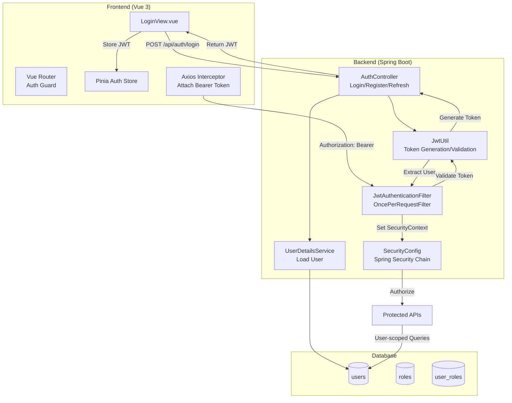
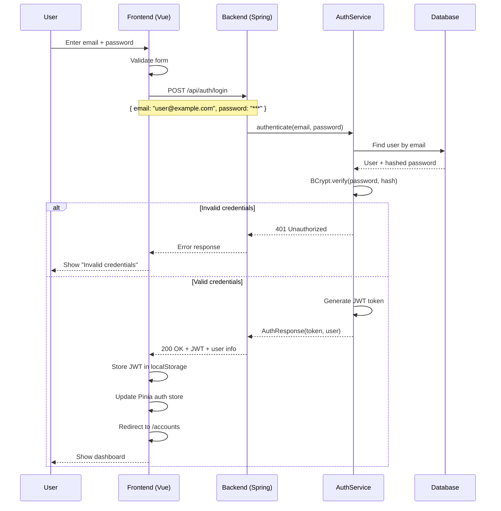
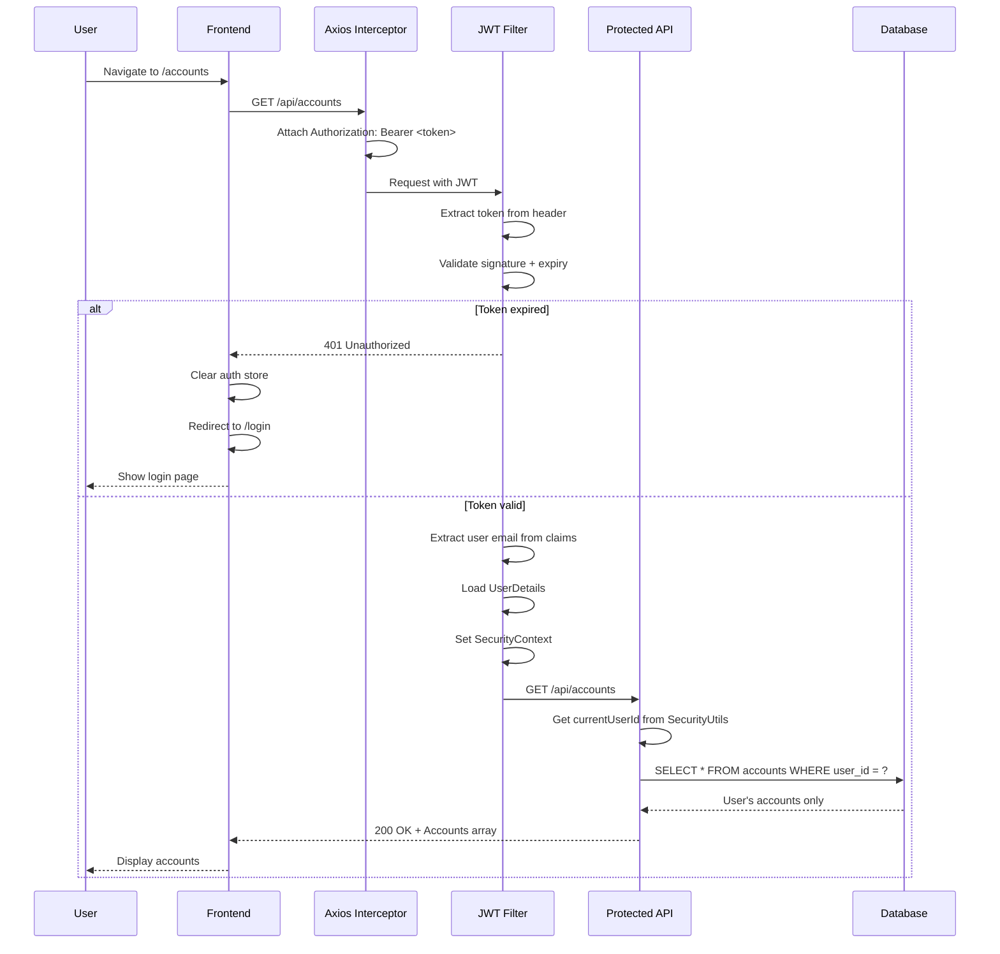

# Authentication & Authorization Design

> **Adding JWT-based auth with Spring Security + Vue Router guards to Money Keeper**

---

## 📋 Table of Contents
- [Current State](#-current-state)
- [Proposed Architecture](#-proposed-architecture)
- [Backend Design](#-backend-design)
- [Frontend Design](#-frontend-design)
- [Database Schema](#-database-schema)
- [API Endpoints](#-api-endpoints)
- [Security Flow](#-security-flow)
- [Migration Strategy](#-migration-strategy)
- [Testing Strategy](#-testing-strategy)

---

## 🏗️ Current State

### Before Auth
```
┌──────────┐     ┌──────────┐     ┌──────────┐
│ Frontend │────▶│ Backend  │────▶│ Database │
│ (No Auth)│     │ (No Auth)│     │ (Open)   │
└──────────┘     └──────────┘     └──────────┘
```

**Problems:**
- ❌ No user isolation — everyone sees the same data
- ❌ No security — anyone can call any API
- ❌ No audit trail — can't track who did what
- ❌ No session management

### After Auth
```
┌──────────┐     ┌──────────┐     ┌──────────┐
│ Frontend │────▶│ Backend  │────▶│ Database │
│ (JWT)    │     │ (Spring  │     │ (User    │
│          │     │  Security│     │  scoped) │
└──────────┘     └──────────┘     └──────────┘
     │                 │
     │                 │
     ▼                 ▼
┌──────────┐     ┌──────────┐
│ Local    │    │ JWT      │
│ Storage  │    │ Validate │
│ (Token)  │    │ + Filter │
└──────────┘     └──────────┘
```

---

## 🏛️ Proposed Architecture

### High-Level Design



### Technology Choices

| Component | Technology | Justification |
|-----------|-----------|---------------|
| **Auth Framework** | Spring Security + JWT | Standard for Spring Boot, stateless |
| **Token Format** | JWT (JSON Web Token) | Stateless, self-contained, no session store needed |
| **JWT Library** | `io.jsonwebtoken:jjwt` | Most popular Java JWT library |
| **Password Hashing** | BCrypt (via Spring Security) | Industry standard, built into Spring |
| **Token Storage** | localStorage (dev) / httpOnly Cookie (prod) | Balance of convenience vs security |
| **Frontend Auth** | Pinia store + Axios interceptor | Consistent with existing stack |
| **Route Guard** | Vue Router `beforeEach` | Prevents unauthorized navigation |

---

## ☕ Backend Design

### Package Structure

```
com.personal.money.management.core
├── auth/
│   ├── domain/
│   │   ├── model/
│   │   │   ├── User.java              # User entity
│   │   │   ├── Role.java              # Role enum
│   │   │   └── UserStatus.java        # Active/Inactive/Locked
│   │   └── repository/
│   │       ├── UserRepository.java
│   │       └── RoleRepository.java
│   ├── application/
│   │   ├── AuthService.java           # Business logic
│   │   ├── dto/
│   │   │   ├── LoginRequest.java
│   │   │   ├── RegisterRequest.java
│   │   │   ├── AuthResponse.java
│   │   │   └── RefreshTokenRequest.java
│   │   └── security/
│   │       ├── JwtUtil.java           # JWT operations
│   │       └── CustomUserDetails.java # UserDetails implementation
│   ├── infrastructure/
│   │   ├── JpaUserRepository.java
│   │   └── jwt/
│   │       ├── JwtAuthenticationFilter.java
│   │       └── JwtConfig.java
│   └── interfaces/
│       └── AuthController.java        # REST endpoints
```

### JWT Token Structure

```json
{
  "sub": "user@example.com",
  "userId": 1,
  "roles": ["ROLE_USER"],
  "iat": 1680000000,
  "exp": 1680003600
}
```

### Security Config (`SecurityConfig.java`)

```java
@Configuration
@EnableWebSecurity
@EnableMethodSecurity
public class SecurityConfig {

    @Bean
    public SecurityFilterChain filterChain(HttpSecurity http) throws Exception {
        http
            .csrf(csrf -> csrf.disable()) // Stateless API
            .cors(cors -> cors.configurationSource(corsConfigurationSource()))
            .sessionManagement(session -> 
                session.sessionCreationPolicy(SessionCreationPolicy.STATELESS))
            .authorizeHttpRequests(auth -> auth
                .requestMatchers("/api/auth/**").permitAll()
                .requestMatchers("/api/public/**").permitAll()
                .requestMatchers("/actuator/health").permitAll()
                .requestMatchers("/swagger-ui/**", "/v3/api-docs/**").permitAll()
                .anyRequest().authenticated()
            )
            .authenticationProvider(authenticationProvider())
            .addFilterBefore(jwtAuthFilter, UsernamePasswordAuthenticationFilter.class);
        
        return http.build();
    }

    @Bean
    public CorsConfigurationSource corsConfigurationSource() {
        CorsConfiguration config = new CorsConfiguration();
        config.setAllowedOrigins(List.of("http://localhost:5173", 
                                          "http://frontend:5173",
                                          "https://*.ngrok-free.app"));
        config.setAllowedMethods(List.of("GET", "POST", "PUT", "DELETE", "OPTIONS"));
        config.setAllowedHeaders(List.of("*"));
        config.setAllowCredentials(true);
        config.setExposedHeaders(List.of("Authorization"));

        UrlBasedCorsConfigurationSource source = new UrlBasedCorsConfigurationSource();
        source.registerCorsConfiguration("/api/**", config);
        return source;
    }
}
```

### JWT Filter (`JwtAuthenticationFilter.java`)

```java
@Component
public class JwtAuthenticationFilter extends OncePerRequestFilter {

    private final JwtUtil jwtUtil;
    private final UserDetailsService userDetailsService;

    @Override
    protected void doFilterInternal(
            @NonNull HttpServletRequest request,
            @NonNull HttpServletResponse response,
            @NonNull FilterChain filterChain
    ) throws ServletException, IOException {
        
        final String authHeader = request.getHeader("Authorization");
        
        if (authHeader == null || !authHeader.startsWith("Bearer ")) {
            filterChain.doFilter(request, response);
            return;
        }

        try {
            final String jwt = authHeader.substring(7);
            final String userEmail = jwtUtil.extractUsername(jwt);

            if (userEmail != null && SecurityContextHolder.getContext().getAuthentication() == null) {
                UserDetails userDetails = userDetailsService.loadUserByUsername(userEmail);

                if (jwtUtil.isTokenValid(jwt, userDetails)) {
                    UsernamePasswordAuthenticationToken authToken = 
                        new UsernamePasswordAuthenticationToken(
                            userDetails, null, userDetails.getAuthorities());
                    authToken.setDetails(new WebAuthenticationDetailsSource().buildDetails(request));
                    SecurityContextHolder.getContext().setAuthentication(authToken);
                }
            }
        } catch (Exception e) {
            logger.error("JWT authentication failed: {}", e.getMessage());
        }

        filterChain.doFilter(request, response);
    }
}
```

### JWT Utility (`JwtUtil.java`)

```java
@Component
public class JwtUtil {

    @Value("${jwt.secret}")
    private String secretKey;

    @Value("${jwt.expiration}")
    private long jwtExpiration; // 24 hours

    public String extractUsername(String token) {
        return extractClaim(token, Claims::getSubject);
    }

    public String generateToken(UserDetails userDetails) {
        Map<String, Object> claims = new HashMap<>();
        claims.put("roles", userDetails.getAuthorities().stream()
            .map(GrantedAuthority::getAuthority)
            .toList());
        
        return Jwts.builder()
            .setClaims(claims)
            .setSubject(userDetails.getUsername())
            .setIssuedAt(new Date())
            .setExpiration(new Date(System.currentTimeMillis() + jwtExpiration))
            .signWith(getSigningKey(), SignatureAlgorithm.HS256)
            .compact();
    }

    public boolean isTokenValid(String token, UserDetails userDetails) {
        final String username = extractUsername(token);
        return (username.equals(userDetails.getUsername())) && !isTokenExpired(token);
    }

    private boolean isTokenExpired(String token) {
        return extractExpiration(token).before(new Date());
    }

    private Claims extractAllClaims(String token) {
        return Jwts.parserBuilder()
            .setSigningKey(getSigningKey())
            .build()
            .parseClaimsJws(token)
            .getBody();
    }

    private Key getSigningKey() {
        byte[] keyBytes = Decoders.BASE64.decode(secretKey);
        return Keys.hmacShaKeyFor(keyBytes);
    }
}
```

### Auth Controller (`AuthController.java`)

```java
@RestController
@RequestMapping("/api/auth")
public class AuthController {

    private final AuthService authService;

    @PostMapping("/register")
    public ResponseEntity<AuthResponse> register(@Valid @RequestBody RegisterRequest request) {
        return ResponseEntity.ok(authService.register(request));
    }

    @PostMapping("/login")
    public ResponseEntity<AuthResponse> login(@Valid @RequestBody LoginRequest request) {
        return ResponseEntity.ok(authService.login(request));
    }

    @PostMapping("/refresh")
    public ResponseEntity<AuthResponse> refresh(@Valid @RequestBody RefreshTokenRequest request) {
        return ResponseEntity.ok(authService.refresh(request));
    }

    @PostMapping("/logout")
    public ResponseEntity<Void> logout() {
        // Stateless — client just discards token
        // For blacklist: add token to revocation list
        return ResponseEntity.noContent().build();
    }

    @GetMapping("/me")
    public ResponseEntity<UserDTO> me() {
        return ResponseEntity.ok(authService.getCurrentUser());
    }
}
```

### Service Layer with User Scoping

```java
// How existing services become user-scoped
@Service
public class AccountService {
    
    private final AccountRepository accountRepository;

    public List<AccountDTO> getMyAccounts() {
        Long userId = SecurityUtils.getCurrentUserId();
        return accountRepository.findByUserId(userId)
            .stream()
            .map(mapper::toDTO)
            .toList();
    }

    public AccountDTO createAccount(CreateAccountRequest request) {
        Long userId = SecurityUtils.getCurrentUserId();
        Account account = mapper.toEntity(request);
        account.setUserId(userId);
        return mapper.toDTO(accountRepository.save(account));
    }

    // All queries automatically filter by current user
    // No user can see another user's data
}
```

```java
// Utility for getting current user in services
@Component
public class SecurityUtils {

    public static Long getCurrentUserId() {
        Authentication auth = SecurityContextHolder.getContext().getAuthentication();
        if (auth == null || !auth.isAuthenticated()) {
            throw new AuthenticationCredentialsNotFoundException("User not authenticated");
        }
        CustomUserDetails userDetails = (CustomUserDetails) auth.getPrincipal();
        return userDetails.getUserId();
    }
}
```

### Maven Dependencies to Add

```xml
<!-- Spring Security -->
<dependency>
    <groupId>org.springframework.boot</groupId>
    <artifactId>spring-boot-starter-security</artifactId>
</dependency>

<!-- JWT -->
<dependency>
    <groupId>io.jsonwebtoken</groupId>
    <artifactId>jjwt-api</artifactId>
    <version>0.11.5</version>
</dependency>
<dependency>
    <groupId>io.jsonwebtoken</groupId>
    <artifactId>jjwt-impl</artifactId>
    <version>0.11.5</version>
    <scope>runtime</scope>
</dependency>
<dependency>
    <groupId>io.jsonwebtoken</groupId>
    <artifactId>jjwt-jackson</artifactId>
    <version>0.11.5</version>
    <scope>runtime</scope>
</dependency>
```

### Application Properties to Add

```properties
# JWT Configuration
jwt.secret=YOUR_BASE64_ENCODED_SECRET_KEY_HERE_AT_LEAST_256_BITS_LONG
jwt.expiration=86400000

# Optional: Refresh token expiry (7 days)
jwt.refresh-expiration=604800000
```

---

## 🖥️ Frontend Design

### Package Structure

```
frontend/src/
├── api/
│   ├── auth.ts                  # Auth API calls
│   └── account.ts               # (existing, now with auth)
├── stores/
│   ├── authStore.ts             # NEW: Pinia auth store
│   ├── account.ts               # (existing, now user-scoped)
│   └── ...
├── router/
│   └── index.ts                 # Updated: route guards
├── views/
│   ├── LoginView.vue            # NEW: Login page
│   ├── RegisterView.vue         # NEW: Register page
│   ├── AccountView.vue          # (existing, now protected)
│   └── ...
├── components/
│   ├── AppLayout.vue            # NEW: Layout with sidebar after login
│   └── Sidebar.vue              # (existing, now conditional)
└── utils/
    └── axios.ts                 # NEW: Axios instance with interceptor
```

### Pinia Auth Store (`stores/authStore.ts`)

```typescript
import { defineStore } from 'pinia'
import { ref, computed } from 'vue'
import { authApi } from '../api/auth'
import router from '../router'

export const useAuthStore = defineStore('auth', () => {
  const user = ref<User | null>(null)
  const token = ref<string | null>(localStorage.getItem('token'))
  const loading = ref(false)

  const isAuthenticated = computed(() => !!token.value)
  const isAdmin = computed(() => user.value?.roles.includes('ROLE_ADMIN'))

  async function login(email: string, password: string) {
    loading.value = true
    try {
      const response = await authApi.login({ email, password })
      token.value = response.token
      user.value = response.user
      localStorage.setItem('token', response.token)
      router.push('/accounts')
    } finally {
      loading.value = false
    }
  }

  async function register(data: RegisterData) {
    loading.value = true
    try {
      const response = await authApi.register(data)
      token.value = response.token
      user.value = response.user
      localStorage.setItem('token', response.token)
      router.push('/accounts')
    } finally {
      loading.value = false
    }
  }

  function logout() {
    token.value = null
    user.value = null
    localStorage.removeItem('token')
    router.push('/login')
  }

  async function fetchCurrentUser() {
    try {
      const response = await authApi.me()
      user.value = response
    } catch {
      logout() // Token expired
    }
  }

  return { user, token, loading, isAuthenticated, isAdmin, login, register, logout, fetchCurrentUser }
})
```

### Axios Interceptor (`utils/axios.ts`)

```typescript
import axios from 'axios'
import { useAuthStore } from '../stores/authStore'
import router from '../router'

const apiClient = axios.create({
  baseURL: import.meta.env.VITE_API_BASE_URL || 'http://localhost:8080',
  timeout: 30000,
  headers: { 'Content-Type': 'application/json' }
})

// Request interceptor — attach Bearer token
apiClient.interceptors.request.use(
  (config) => {
    const authStore = useAuthStore()
    if (authStore.token) {
      config.headers.Authorization = `Bearer ${authStore.token}`
    }
    return config
  },
  (error) => Promise.reject(error)
)

// Response interceptor — handle 401
apiClient.interceptors.response.use(
  (response) => response,
  (error) => {
    if (error.response?.status === 401) {
      const authStore = useAuthStore()
      authStore.logout() // Token expired/invalid
    }
    return Promise.reject(error)
  }
)

export default apiClient
```

### Vue Router Guard (`router/index.ts`)

```typescript
import { createRouter, createWebHistory } from 'vue-router'
import { useAuthStore } from '../stores/authStore'

const router = createRouter({
  history: createWebHistory(import.meta.env.BASE_URL),
  routes: [
    {
      path: '/login',
      name: 'login',
      component: () => import('../views/LoginView.vue'),
      meta: { requiresAuth: false }
    },
    {
      path: '/register',
      name: 'register',
      component: () => import('../views/RegisterView.vue'),
      meta: { requiresAuth: false }
    },
    {
      path: '/',
      redirect: '/accounts'
    },
    {
      path: '/categories',
      name: 'categories',
      component: () => import('../views/CategoryView.vue'),
      meta: { requiresAuth: true }
    },
    {
      path: '/accounts',
      name: 'accounts',
      component: () => import('../views/AccountView.vue'),
      meta: { requiresAuth: true }
    },
    {
      path: '/tax-calculator',
      name: 'tax-calculator',
      component: () => import('../views/TaxCalculatorView.vue'),
      meta: { requiresAuth: true }
    },
    {
      path: '/settings',
      name: 'settings',
      component: () => import('../views/SettingsView.vue'),
      meta: { requiresAuth: true, requiresAdmin: true }
    }
  ]
})

// Navigation guard
router.beforeEach(async (to, from, next) => {
  const authStore = useAuthStore()

  // Skip auth check for login/register
  if (to.meta.requiresAuth === false) {
    // If already logged in, redirect to home
    if (authStore.isAuthenticated && to.name === 'login') {
      return next('/accounts')
    }
    return next()
  }

  // Protected routes
  if (!authStore.isAuthenticated) {
    return next('/login')
  }

  // Check admin routes
  if (to.meta.requiresAdmin && !authStore.isAdmin) {
    return next('/') // Redirect non-admins
  }

  next()
})

export default router
```

### Login View (`views/LoginView.vue`)

```vue
<template>
  <div class="login-container">
    <el-card class="login-card">
      <template #header>
        <h2>💰 Money Keeper</h2>
        <p class="subtitle">Sign in to your account</p>
      </template>

      <el-form 
        ref="formRef"
        :model="form"
        :rules="rules"
        @submit.prevent="handleLogin"
        label-position="top"
      >
        <el-form-item label="Email" prop="email">
          <el-input 
            v-model="form.email" 
            type="email" 
            placeholder="your@email.com"
            :prefix-icon="User"
          />
        </el-form-item>

        <el-form-item label="Password" prop="password">
          <el-input 
            v-model="form.password" 
            type="password" 
            placeholder="Enter password"
            show-password
            :prefix-icon="Lock"
          />
        </el-form-item>

        <el-form-item>
          <el-button 
            type="primary" 
            native-type="submit" 
            :loading="authStore.loading"
            class="submit-btn"
          >
            {{ authStore.loading ? 'Signing in...' : 'Sign In' }}
          </el-button>
        </el-form-item>
      </el-form>

      <div class="register-link">
        Don't have an account?
        <router-link to="/register">Register here</router-link>
      </div>
    </el-card>
  </div>
</template>

<script setup lang="ts">
import { ref, reactive } from 'vue'
import { User, Lock } from '@element-plus/icons-vue'
import { useAuthStore } from '../stores/authStore'
import type { FormInstance, FormRules } from 'element-plus'

const authStore = useAuthStore()
const formRef = ref<FormInstance>()

const form = reactive({
  email: '',
  password: ''
})

const rules: FormRules = {
  email: [
    { required: true, message: 'Email is required', trigger: 'blur' },
    { type: 'email', message: 'Invalid email format', trigger: 'blur' }
  ],
  password: [
    { required: true, message: 'Password is required', trigger: 'blur' },
    { min: 6, message: 'Password must be at least 6 characters', trigger: 'blur' }
  ]
}

async function handleLogin() {
  const valid = await formRef.value?.validate().catch(() => false)
  if (!valid) return
  
  await authStore.login(form.email, form.password)
}
</script>

<style scoped>
.login-container {
  display: flex;
  justify-content: center;
  align-items: center;
  min-height: 100vh;
  background: linear-gradient(135deg, #667eea 0%, #764ba2 100%);
}

.login-card {
  width: 400px;
  max-width: 90vw;
}

.subtitle {
  color: #666;
  font-size: 14px;
  margin-top: 4px;
}

.submit-btn {
  width: 100%;
}

.register-link {
  text-align: center;
  font-size: 14px;
  color: #666;
}
</style>
```

### Updated API Module (with auth)

```typescript
// api/auth.ts
import apiClient from '../utils/axios'

export const authApi = {
  login(data: { email: string; password: string }) {
    return apiClient.post('/api/auth/login', data).then(r => r.data)
  },
  register(data: RegisterData) {
    return apiClient.post('/api/auth/register', data).then(r => r.data)
  },
  me() {
    return apiClient.get('/api/auth/me').then(r => r.data)
  },
  refresh(refreshToken: string) {
    return apiClient.post('/api/auth/refresh', { refreshToken }).then(r => r.data)
  }
}
```

---

## 🗄️ Database Schema

### Migration Files

**V6__create_users_table.sql** (Oracle)
```sql
CREATE TABLE users (
    id NUMBER GENERATED BY DEFAULT AS IDENTITY PRIMARY KEY,
    email VARCHAR2(255) NOT NULL UNIQUE,
    password VARCHAR2(255) NOT NULL,
    full_name VARCHAR2(255),
    status VARCHAR2(20) DEFAULT 'ACTIVE' NOT NULL,
    created_at TIMESTAMP DEFAULT CURRENT_TIMESTAMP,
    updated_at TIMESTAMP DEFAULT CURRENT_TIMESTAMP,
    last_login_at TIMESTAMP,
    CONSTRAINT chk_user_status CHECK (status IN ('ACTIVE', 'INACTIVE', 'LOCKED'))
);

CREATE TABLE roles (
    id NUMBER GENERATED BY DEFAULT AS IDENTITY PRIMARY KEY,
    name VARCHAR2(50) NOT NULL UNIQUE,
    description VARCHAR2(255)
);

CREATE TABLE user_roles (
    user_id NUMBER NOT NULL,
    role_id NUMBER NOT NULL,
    PRIMARY KEY (user_id, role_id),
    FOREIGN KEY (user_id) REFERENCES users(id) ON DELETE CASCADE,
    FOREIGN KEY (role_id) REFERENCES roles(id) ON DELETE CASCADE
);

-- Insert default roles
INSERT INTO roles (name, description) VALUES ('ROLE_USER', 'Standard user');
INSERT INTO roles (name, description) VALUES ('ROLE_ADMIN', 'Administrator');

-- Create index for performance
CREATE INDEX idx_users_email ON users(email);
CREATE INDEX idx_user_roles_user_id ON user_roles(user_id);
```

**V6__create_users_table.sql** (H2)
```sql
CREATE TABLE users (
    id BIGINT AUTO_INCREMENT PRIMARY KEY,
    email VARCHAR(255) NOT NULL UNIQUE,
    password VARCHAR(255) NOT NULL,
    full_name VARCHAR(255),
    status VARCHAR(20) DEFAULT 'ACTIVE' NOT NULL,
    created_at TIMESTAMP DEFAULT CURRENT_TIMESTAMP,
    updated_at TIMESTAMP DEFAULT CURRENT_TIMESTAMP,
    last_login_at TIMESTAMP
);

CREATE TABLE roles (
    id BIGINT AUTO_INCREMENT PRIMARY KEY,
    name VARCHAR(50) NOT NULL UNIQUE,
    description VARCHAR(255)
);

CREATE TABLE user_roles (
    user_id BIGINT NOT NULL,
    role_id BIGINT NOT NULL,
    PRIMARY KEY (user_id, role_id),
    FOREIGN KEY (user_id) REFERENCES users(id) ON DELETE CASCADE,
    FOREIGN KEY (role_id) REFERENCES roles(id) ON DELETE CASCADE
);

INSERT INTO roles (name, description) VALUES ('ROLE_USER', 'Standard user');
INSERT INTO roles (name, description) VALUES ('ROLE_ADMIN', 'Administrator');
```

### Domain Entity

```java
// User.java
@Entity
@Table(name = "users")
public class User {

    @Id
    @GeneratedValue(strategy = GenerationType.IDENTITY)
    private Long id;

    @Column(nullable = false, unique = true)
    private String email;

    @Column(nullable = false)
    private String password; // BCrypt hashed

    @Column(name = "full_name")
    private String fullName;

    @Enumerated(EnumType.STRING)
    @Column(nullable = false)
    private UserStatus status = UserStatus.ACTIVE;

    @Column(name = "last_login_at")
    private LocalDateTime lastLoginAt;

    @CreatedDate
    @Column(name = "created_at", updatable = false)
    private LocalDateTime createdAt;

    @LastModifiedDate
    @Column(name = "updated_at")
    private LocalDateTime updatedAt;

    @ManyToMany(fetch = FetchType.EAGER)
    @JoinTable(
        name = "user_roles",
        joinColumns = @JoinColumn(name = "user_id"),
        inverseJoinColumns = @JoinColumn(name = "role_id")
    )
    private Set<Role> roles = new HashSet<>();
}
```

### Adding `user_id` to Existing Tables

**V7__add_user_id_to_accounts.sql**
```sql
ALTER TABLE accounts ADD user_id NUMBER;
ALTER TABLE accounts ADD CONSTRAINT fk_accounts_user FOREIGN KEY (user_id) REFERENCES users(id);
CREATE INDEX idx_accounts_user_id ON accounts(user_id);

-- Migrate existing data to default admin user
-- (handled by application logic)
```

---

## 🔄 Security Flow

### Login Flow



### Authenticated Request Flow



---

## 📋 API Endpoint Security Matrix

| Endpoint | Method | Auth Required | Roles | Notes |
|----------|--------|---------------|-------|-------|
| `/api/auth/login` | POST | ❌ | — | Public |
| `/api/auth/register` | POST | ❌ | — | Public |
| `/api/auth/refresh` | POST | ❌ | — | Requires refresh token |
| `/api/auth/me` | GET | ✅ | Any | Returns current user |
| `/api/auth/logout` | POST | ✅ | Any | Optional blacklist |
| `/api/accounts/**` | ALL | ✅ | ROLE_USER | User-scoped queries |
| `/api/categories/**` | ALL | ✅ | ROLE_USER | User-scoped queries |
| `/api/transactions/**` | ALL | ✅ | ROLE_USER | User-scoped queries |
| `/api/tax/**` | ALL | ✅ | ROLE_USER | User-scoped queries |
| `/api/settings/**` | ALL | ✅ | ROLE_ADMIN | Admin only |
| `/api/admin/**` | ALL | ✅ | ROLE_ADMIN | Admin operations |
| `/actuator/health` | GET | ❌ | — | Health check |

---

## 📝 Implementation Plan

### Phase 1: Backend Auth (Days 1-3)

| Step | Files | Description |
|------|-------|-------------|
| 1. Add dependencies | `pom.xml` | Add spring-security, jjwt |
| 2. Create User entity | `auth/domain/model/User.java` | JPA entity |
| 3. Create Role entity | `auth/domain/model/Role.java` | JPA entity |
| 4. Create migrations | `V6__*.sql`, `V7__*.sql` | DB migrations |
| 5. Create JwtUtil | `auth/application/security/JwtUtil.java` | Token operations |
| 6. Create JWT filter | `auth/infrastructure/jwt/JwtAuthenticationFilter.java` | Request filter |
| 7. Create SecurityConfig | `auth/infrastructure/SecurityConfig.java` | Spring Security config |
| 8. Create AuthController | `auth/interfaces/AuthController.java` | Login/Register endpoints |
| 9. Create AuthService | `auth/application/AuthService.java` | Business logic |
| 10. Create SecurityUtils | `auth/application/security/SecurityUtils.java` | Current user helper |
| 11. Add user_id to services | `account/*`, `category/*`, etc. | Scope queries to user |

### Phase 2: Frontend Auth (Days 4-5)

| Step | Files | Description |
|------|-------|-------------|
| 1. Create Axios instance | `utils/axios.ts` | Interceptor |
| 2. Create auth store | `stores/authStore.ts` | Pinia store |
| 3. Create Login view | `views/LoginView.vue` | Login page |
| 4. Create Register view | `views/RegisterView.vue` | Registration |
| 5. Update router | `router/index.ts` | Route guards |
| 6. Create AppLayout | `components/AppLayout.vue` | Post-login layout |
| 7. Update Sidebar | `components/Sidebar.vue` | Conditional rendering |
| 8. Update existing views | `views/*.vue` | Add user context |

### Phase 3: Testing (Days 6-7)

| Step | Description |
|------|-------------|
| 1. Unit tests | Test JwtUtil, AuthService |
| 2. Integration tests | Test auth endpoints |
| 3. E2E tests | Login flow, protected routes |
| 4. Security tests | Invalid tokens, expired tokens, CORS |

---

## 🧪 Testing Strategy

### Backend Unit Tests

```java
@ExtendWith(MockitoExtension.class)
class JwtUtilTest {

    private JwtUtil jwtUtil;
    
    @BeforeEach
    void setUp() {
        jwtUtil = new JwtUtil();
        // Set secret via reflection for testing
    }

    @Test
    void shouldGenerateAndValidateToken() {
        UserDetails userDetails = new CustomUserDetails(
            1L, "test@example.com", "pass", List.of(new SimpleGrantedAuthority("ROLE_USER")));

        String token = jwtUtil.generateToken(userDetails);
        
        assertThat(jwtUtil.extractUsername(token)).isEqualTo("test@example.com");
        assertThat(jwtUtil.isTokenValid(token, userDetails)).isTrue();
    }

    @Test
    void shouldRejectExpiredToken() {
        // Token with past expiry
        String expiredToken = "...";
        assertThat(jwtUtil.isTokenExpired(expiredToken)).isTrue();
    }
}
```

### Backend Integration Tests

```java
@SpringBootTest(webEnvironment = WebEnvironment.RANDOM_PORT)
@ActiveProfiles("test")
class AuthControllerIntegrationTest {

    @Autowired
    private TestRestTemplate restTemplate;

    @Test
    void shouldRegisterAndLogin() {
        // Register
        var register = new RegisterRequest("new@user.com", "password123", "New User");
        var registerResponse = restTemplate.postForEntity(
            "/api/auth/register", register, AuthResponse.class);
        assertThat(registerResponse.getStatusCode()).isEqualTo(HttpStatus.OK);
        assertThat(registerResponse.getBody().getToken()).isNotBlank();

        // Login with credentials
        var login = new LoginRequest("new@user.com", "password123");
        var loginResponse = restTemplate.postForEntity(
            "/api/auth/login", login, AuthResponse.class);
        assertThat(loginResponse.getStatusCode()).isEqualTo(HttpStatus.OK);
    }

    @Test
    void shouldRejectInvalidCredentials() {
        var login = new LoginRequest("wrong@email.com", "wrongpass");
        var response = restTemplate.postForEntity(
            "/api/auth/login", login, AuthResponse.class);
        assertThat(response.getStatusCode()).isEqualTo(HttpStatus.UNAUTHORIZED);
    }

    @Test
    void shouldRequireAuthForProtectedEndpoints() {
        var response = restTemplate.getForEntity("/api/accounts", String.class);
        assertThat(response.getStatusCode()).isEqualTo(HttpStatus.UNAUTHORIZED);
    }
}
```

### E2E Tests

```gherkin
Feature: Authentication

  Scenario: User registers a new account
    Given I am on the registration page
    When I fill in the registration form with:
      | field      | value              |
      | email      | test@example.com   |
      | password   | SecurePass123      |
      | full_name  | Test User          |
    And I submit the registration form
    Then I should be redirected to the accounts page
    And I should see "Welcome, Test User" in the header

  Scenario: User logs in successfully
    Given a user exists with email "test@example.com" and password "SecurePass123"
    When I navigate to the login page
    And I log in with email "test@example.com" and password "SecurePass123"
    Then I should be redirected to the accounts page
    And I should see my accounts list

  Scenario: User sees error with wrong password
    Given a user exists with email "test@example.com" and password "SecurePass123"
    When I log in with email "test@example.com" and password "wrongpassword"
    Then I should see an error "Invalid email or password"
    And I should remain on the login page

  Scenario: Unauthenticated user is redirected
    Given I am not logged in
    When I navigate to the accounts page
    Then I should be redirected to the login page
```

---

## ⚠️ Security Considerations

### Best Practices

| Practice | Implementation |
|----------|---------------|
| **Password Hashing** | BCrypt with strength 12 |
| **Token Expiry** | 24 hours (short-lived) |
| **HTTPS Only** | Enforce in production |
| **No Token in URL** | Header only (Authorization: Bearer) |
| **CORS** | Whitelist specific origins only |
| **Rate Limiting** | On login endpoint (future) |
| **Account Lockout** | After 5 failed attempts (future) |
| **Refresh Tokens** | Optional, stored securely |

### What NOT to Do

- ❌ Don't store plain-text passwords
- ❌ Don't put JWT secret in code (use environment variable)
- ❌ Don't expose stack traces on auth errors
- ❌ Don't use `localStorage` for production (use httpOnly cookie)
- ❌ Don't leak user enumeration (always return generic "Invalid credentials")
- ❌ Don't log JWT tokens

### Environment Variables

```properties
# application-ci.properties (CI)
jwt.secret=base64encoded-secret-for-ci-environment-must-be-256-bits-long

# Secret in GitHub Actions
JWT_SECRET: ${{ secrets.JWT_SECRET }}
```

---

## 📦 Summary

### What Changes

| Layer | Changes | Impact |
|-------|---------|--------|
| **Backend** | + ~15 new files | Auth module, filters, security config |
| **Frontend** | + ~5 new files | Login, register, interceptor, guard |
| **Database** | +3 tables, +1 FK per entity | V6, V7 migrations |
| **Existing Code** | ~10 files modified | Add userId filter to queries |
| **CI/CD** | +1 secret (`JWT_SECRET`) | Low impact |

### Effort Estimate

| Phase | Duration | Outcome |
|-------|----------|---------|
| Backend auth | 3 days | Login/register working via Postman |
| Frontend auth | 2 days | Login UI, route protection, token handling |
| User scoping | 1 day | Existing APIs filter by user |
| Testing | 1 day | Unit, integration, E2E tests |

**Total: ~7 days** for a complete, production-ready auth system.

---

> **Last Updated**: 2026-07-16  
> **See also**: [Architecture](architecture.md), [Development Guide](DEVELOPMENT_GUIDE.md), [CI/CD Reference](CI_CD_REFERENCE.md)