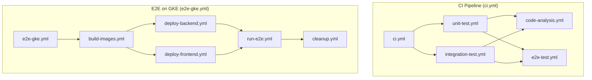
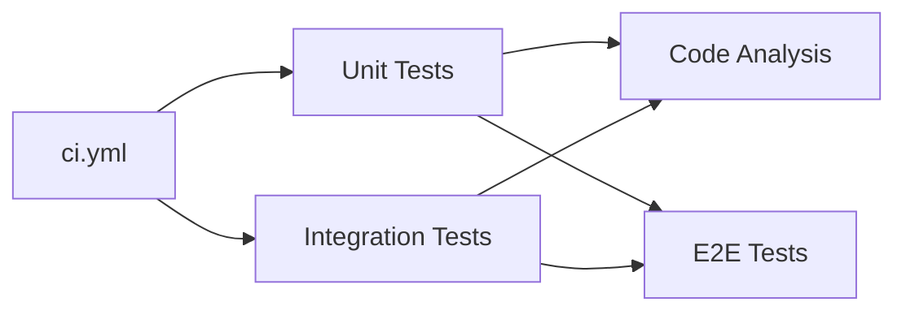
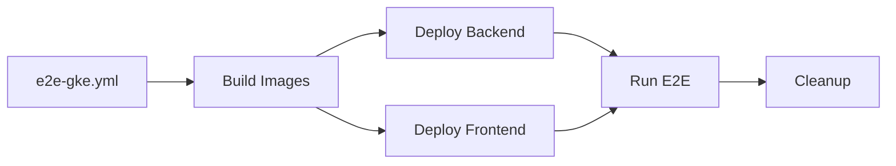

# CI/CD Reference

> **Complete pipeline documentation: workflows, actions, configuration, and troubleshooting**

---

## 📋 Table of Contents
- [Pipeline Overview](#-pipeline-overview)
- [Workflow Definitions](#-workflow-definitions)
- [Composite Actions](#-composite-actions)
- [Configuration Reference](#-configuration-reference)
- [Artifact Contract](#-artifact-contract)
- [Secrets & Variables](#-secrets--variables)
- [Troubleshooting](#-troubleshooting)
- [CLI Quick Reference](#-cli-quick-reference)

---

## 📊 Pipeline Overview

### Pipeline Architecture



### File Map

```
.github/
├── workflows/
│   ├── ci.yml                  # Main CI entrypoint (auto)
│   ├── e2e-gke.yml            # E2E on GKE (manual)
│   ├── unit-test.yml          # Reusable: unit tests
│   ├── integration-test.yml   # Reusable: integration tests
│   ├── code-analysis.yml      # Reusable: SonarCloud
│   ├── e2e-test.yml           # Reusable: Docker Compose E2E
│   ├── build-images.yml       # Reusable: Docker build
│   ├── deploy-backend.yml     # Reusable: backend + ngrok
│   ├── deploy-frontend.yml    # Reusable: GKE deploy
│   ├── run-e2e.yml            # Reusable: Playwright tests
│   ├── cleanup.yml            # Reusable: cleanup resources
│   ├── eslint.yaml            # Frontend lint
│   ├── docker-publish.yml     # Docker image publish
│   ├── deploy-pages.yml       # GitHub Pages deploy
│   ├── static.yml             # Static analysis
│   ├── pr-sequential-checks.yml
│   ├── WORKFLOWS.md
│   └── README.md
└── actions/
    ├── setup-java-maven/
    ├── run-maven-tests/
    ├── setup-oracle-flyway/
    ├── upload-test-artifacts/
    ├── merge-jacoco-reports/
    ├── run-sonar-scan/
    ├── teardown-docker-compose/
    ├── run-eslint/
    ├── prepare-e2e-stack/
    ├── run-e2e-suite/
    ├── publish-allure-report/
    └── setup-gcp/
```

---

## 🔄 Complete Workflow Definitions

### 1. CI Pipeline (`ci.yml`)
**File:** `.github/workflows/ci.yml`

**Triggers:** `push` (develop/master), `pull_request` (develop/master), `workflow_dispatch`, `workflow_call`

**Paths:** `backend/**`, `frontend/**`

**Job Dependencies:**


**Full YAML:**
```yaml
name: CI

on:
  workflow_call:
  workflow_dispatch:
  push:
    branches: [develop, master]
    paths: ['backend/**', 'frontend/**']
  pull_request:
    branches: [develop, master]
    paths: ['backend/**', 'frontend/**']

permissions:
  contents: read
  pages: write
  id-token: write

jobs:
  unit-test:
    name: Unit Tests
    uses: ./.github/workflows/unit-test.yml
    secrets: inherit

  integration-test:
    name: Integration Tests
    uses: ./.github/workflows/integration-test.yml
    secrets: inherit

  analysis:
    name: Code Analysis
    needs: [unit-test, integration-test]
    uses: ./.github/workflows/code-analysis.yml
    secrets: inherit

  e2e-test:
    name: E2E Tests
    needs: [unit-test, integration-test]
    uses: ./.github/workflows/e2e-test.yml
    secrets: inherit
```

---

### 2. E2E on GKE (`e2e-gke.yml`)
**File:** `.github/workflows/e2e-gke.yml`

**Trigger:** `workflow_dispatch` with branch input

**Job Dependencies:**


**Full YAML:**
```yaml
name: E2E Test with Frontend on GKE and Backend on Runner

on:
  workflow_dispatch:
    inputs:
      branch:
        description: 'Branch to test'
        required: true
        default: 'develop'
        type: string

concurrency:
  group: ${{ github.workflow }}-${{ github.ref }}
  cancel-in-progress: true

permissions:
  contents: read
  packages: write
  id-token: write

env:
  REGISTRY: ghcr.io/${{ github.repository_owner }}
  IMAGE_TAG: ${{ github.sha }}
  GCP_PROJECT_ID: ${{ secrets.GCP_PROJECT_ID }}
  GKE_CLUSTER: ${{ vars.GKE_CLUSTER }}
  GKE_ZONE: ${{ vars.GKE_ZONE }}

jobs:
  build-images:
    uses: ./.github/workflows/build-images.yml
    with:
      branch: ${{ inputs.branch }}
    secrets: inherit

  deploy-backend:
    needs: build-images
    uses: ./.github/workflows/deploy-backend.yml
    with:
      branch: ${{ inputs.branch }}
      backend-image: ${{ needs.build-images.outputs.backend-image }}
    secrets: inherit

  deploy-frontend:
    needs: [build-images, deploy-backend]
    uses: ./.github/workflows/deploy-frontend.yml
    with:
      branch: ${{ inputs.branch }}
      frontend-image: ${{ needs.build-images.outputs.frontend-image }}
      backend-url: ${{ needs.deploy-backend.outputs.backend-url }}
    secrets: inherit

  run-e2e:
    needs: [deploy-backend, deploy-frontend]
    uses: ./.github/workflows/run-e2e.yml
    with:
      branch: ${{ inputs.branch }}
      backend-url: ${{ needs.deploy-backend.outputs.backend-url }}
      frontend-url: ${{ needs.deploy-frontend.outputs.frontend-url }}
    secrets: inherit

  cleanup:
    needs: run-e2e
    if: always()
    uses: ./.github/workflows/cleanup.yml
    with:
      branch: ${{ inputs.branch }}
    secrets: inherit
```

---

### 3. Reusable Workflow: Unit Test (`unit-test.yml`)
**File:** `.github/workflows/unit-test.yml`

```yaml
name: Unit Tests

on:
  workflow_call:
  workflow_dispatch:

jobs:
  unit-tests:
    runs-on: ubuntu-latest
    steps:
      - uses: actions/checkout@v4

      - uses: ./.github/actions/setup-java-maven

      - name: Run unit tests
        uses: ./.github/actions/run-maven-tests
        with:
          profile: unit-test
          report-pattern: '**/target/surefire-reports/TEST-*.xml'

      - uses: ./.github/actions/upload-test-artifacts
        with:
          surefire-name: surefire-report-unit
          jacoco-name: jacoco-report-unit
```

---

### 4. Reusable Workflow: Integration Test (`integration-test.yml`)
**File:** `.github/workflows/integration-test.yml`

```yaml
name: Integration Tests

on:
  workflow_call:
  workflow_dispatch:

jobs:
  integration-tests:
    runs-on: ubuntu-latest
    steps:
      - uses: actions/checkout@v4

      - uses: ./.github/actions/setup-java-maven

      - uses: ./.github/actions/setup-oracle-flyway
        with:
          oracle-password: ${{ secrets.ORACLE_PASSWORD_SECRET }}

      - name: Run integration tests
        uses: ./.github/actions/run-maven-tests
        with:
          profile: integration-test
          report-pattern: '**/target/failsafe-reports/TEST-*.xml'

      - uses: ./.github/actions/upload-test-artifacts
        with:
          surefire-name: surefire-report-integration
          jacoco-name: jacoco-report-integration

      - uses: ./.github/actions/teardown-docker-compose
        if: always()
```

---

### 5. Reusable Workflow: Code Analysis (`code-analysis.yml`)
**File:** `.github/workflows/code-analysis.yml`

```yaml
name: Code Analysis

on:
  workflow_call:
  workflow_dispatch:

jobs:
  analysis:
    runs-on: ubuntu-latest
    steps:
      - uses: actions/checkout@v4
        with:
          fetch-depth: 0  # Full history for Sonar

      - uses: ./.github/actions/setup-java-maven

      - uses: ./.github/actions/merge-jacoco-reports

      - name: Compile for analysis
        run: mvn compile -q

      - uses: ./.github/actions/run-sonar-scan
        with:
          sonar-token: ${{ secrets.SONAR_TOKEN }}
          project-key: ${{ vars.SONAR_PROJECT_KEY }}
          organization: ${{ vars.SONAR_ORGANIZATION }}
```

---

### 6. Reusable Workflow: E2E Test (`e2e-test.yml`)
**File:** `.github/workflows/e2e-test.yml`

```yaml
name: E2E Tests

on:
  workflow_call:
  workflow_dispatch:

jobs:
  e2e-tests:
    runs-on: ubuntu-latest
    steps:
      - uses: actions/checkout@v4

      - uses: ./.github/actions/prepare-e2e-stack
        with:
          oracle-password: ${{ secrets.ORACLE_PASSWORD_SECRET }}

      - uses: ./.github/actions/run-e2e-suite

      - uses: ./.github/actions/publish-allure-report
        if: always()
```

---

### 7. Reusable Workflow: Build Images (`build-images.yml`)
**File:** `.github/workflows/build-images.yml`

```yaml
name: Build Images

on:
  workflow_call:
    inputs:
      branch:
        required: true
        type: string
    outputs:
      backend-image:
        value: ${{ jobs.build.outputs.backend-image }}
      frontend-image:
        value: ${{ jobs.build.outputs.frontend-image }}

jobs:
  build:
    runs-on: ubuntu-latest
    outputs:
      backend-image: ${{ steps.backend.outputs.digest }}
      frontend-image: ${{ steps.frontend.outputs.digest }}
    steps:
      - uses: actions/checkout@v4
        with:
          ref: ${{ inputs.branch }}

      - name: Set up Docker Buildx
        uses: docker/setup-buildx-action@v3

      - name: Log in to GHCR
        uses: docker/login-action@v3
        with:
          registry: ghcr.io
          username: ${{ github.actor }}
          password: ${{ secrets.GITHUB_TOKEN }}

      - name: Build and push backend
        id: backend
        uses: docker/build-push-action@v5
        with:
          context: ./backend
          push: true
          tags: ${{ env.REGISTRY }}/money-keeper-backend:${{ env.IMAGE_TAG }}

      - name: Build and push frontend
        id: frontend
        uses: docker/build-push-action@v5
        with:
          context: ./frontend
          push: true
          tags: ${{ env.REGISTRY }}/money-keeper-frontend:${{ env.IMAGE_TAG }}
```

### 8. Reusable Workflow: Deploy Backend (`deploy-backend.yml`)
**File:** `.github/workflows/deploy-backend.yml`

```yaml
name: Deploy Backend

on:
  workflow_call:
    inputs:
      branch:
        required: true
        type: string
      backend-image:
        required: true
        type: string
    outputs:
      backend-url:
        value: ${{ jobs.deploy.outputs.backend-url }}

jobs:
  deploy:
    runs-on: ubuntu-latest
    outputs:
      backend-url: ${{ steps.ngrok.outputs.url }}
    steps:
      - uses: actions/checkout@v4
        with:
          ref: ${{ inputs.branch }}

      - uses: ./.github/actions/setup-oracle-flyway
        with:
          oracle-password: ${{ secrets.ORACLE_PASSWORD_SECRET }}

      - name: Start backend
        run: |
          docker run -d --name money-keeper-backend \
            -p 8080:8080 \
            -e ORACLE_PASSWORD=${{ secrets.ORACLE_PASSWORD_SECRET }} \
            ${{ inputs.backend-image }}

      - name: Start ngrok tunnel
        id: ngrok
        run: |
          ngrok http 8080 --log=stdout > /dev/null &
          sleep 2
          curl -s http://localhost:4040/api/tunnels | jq -r '.tunnels[0].public_url'
```

### 9. Reusable Workflow: Deploy Frontend (`deploy-frontend.yml`)
**File:** `.github/workflows/deploy-frontend.yml`

```yaml
name: Deploy Frontend

on:
  workflow_call:
    inputs:
      branch:
        required: true
        type: string
      frontend-image:
        required: true
        type: string
      backend-url:
        required: true
        type: string
    outputs:
      frontend-url:
        value: ${{ jobs.deploy.outputs.frontend-url }}

jobs:
  deploy:
    runs-on: ubuntu-latest
    outputs:
      frontend-url: ${{ steps.lb.outputs.url }}
    steps:
      - uses: actions/checkout@v4
        with:
          ref: ${{ inputs.branch }}

      - uses: ./.github/actions/setup-gcp

      - name: Deploy with Helm
        run: |
          helm upgrade --install money-keeper ./k8s \
            --namespace default \
            --set frontend.image.repository=${{ env.REGISTRY }}/money-keeper-frontend \
            --set frontend.image.tag=${{ inputs.frontend-image }} \
            --set frontend.env.VITE_API_BASE_URL=${{ inputs.backend-url }}

      - name: Expose LoadBalancer
        id: lb
        run: |
          kubectl patch svc money-keeper-frontend -p '{"spec":{"type":"LoadBalancer"}}'
          sleep 30
          echo "url=$(kubectl get svc money-keeper-frontend -o json | jq -r '.status.loadBalancer.ingress[0].ip')" >> $GITHUB_OUTPUT
```

### 10. Reusable Workflow: Run E2E (`run-e2e.yml`)
**File:** `.github/workflows/run-e2e.yml`

```yaml
name: Run E2E Tests

on:
  workflow_call:
    inputs:
      branch:
        required: true
        type: string
      backend-url:
        required: true
        type: string
      frontend-url:
        required: true
        type: string

jobs:
  tests:
    runs-on: ubuntu-latest
    steps:
      - uses: actions/checkout@v4
        with:
          ref: ${{ inputs.branch }}

      - uses: actions/setup-node@v4
        with:
          node-version: 18

      - name: Cache npm
        uses: actions/cache@v3
        with:
          path: ~/.npm
          key: npm-${{ hashFiles('e2e/package-lock.json') }}

      - name: Install dependencies
        working-directory: ./e2e
        run: npm ci

      - name: Install Playwright browsers
        working-directory: ./e2e
        run: npx playwright install --with-deps

      - name: Run E2E tests
        working-directory: ./e2e
        env:
          BASE_URL: ${{ inputs.frontend-url }}
          API_BASE_URL: ${{ inputs.backend-url }}
        run: npm test

      - uses: actions/upload-artifact@v4
        if: always()
        with:
          name: e2e-test-results
          path: e2e/test-results/
```

### 11. Reusable Workflow: Cleanup (`cleanup.yml`)
**File:** `.github/workflows/cleanup.yml`

```yaml
name: Cleanup

on:
  workflow_call:
    inputs:
      branch:
        required: true
        type: string

jobs:
  cleanup:
    runs-on: ubuntu-latest
    steps:
      - uses: actions/checkout@v4
        with:
          ref: ${{ inputs.branch }}

      - uses: ./.github/actions/setup-gcp

      - name: Delete GKE frontend
        run: |
          helm uninstall money-keeper --ignore-not-found
          kubectl delete deployment money-keeper-frontend --ignore-not-found
          kubectl delete service money-keeper-frontend --ignore-not-found

      - name: Stop Docker containers
        run: |
          docker stop $(docker ps -q) 2>/dev/null || true
          docker system prune -f --volumes
```

---

## 🛠 Composite Actions Reference

### Action: `setup-java-maven`
**Path:** `.github/actions/setup-java-maven/action.yml`

```yaml
name: Setup Java and Maven
description: Install JDK 17, configure Maven, and cache dependencies

inputs:
  java-version:
    description: JDK version
    default: '17'

runs:
  using: composite
  steps:
    - uses: actions/setup-java@v4
      with:
        distribution: temurin
        java-version: ${{ inputs.java-version }}
        cache: maven

    - name: Configure Maven settings
      shell: bash
      run: |
        mkdir -p ~/.m2
        cat > ~/.m2/settings.xml <<EOF
        <settings>
          <localRepository>~/.m2/repository</localRepository>
        </settings>
        EOF
```

### Action: `run-maven-tests`
**Path:** `.github/actions/run-maven-tests/action.yml`

```yaml
name: Run Maven Tests
description: Run Maven tests with specified profile

inputs:
  profile:
    description: Maven profile to use
    required: true
  report-pattern:
    description: Glob pattern for test reports
    required: true

runs:
  using: composite
  steps:
    - name: Run tests
      shell: bash
      working-directory: backend
      run: mvn test -P ${{ inputs.profile }} -B

    - name: Aggregate XML reports
      shell: bash
      run: |
        find backend -name 'TEST-*.xml' -exec cp {} ./target/ \;
```

### Action: `setup-oracle-flyway`
**Path:** `.github/actions/setup-oracle-flyway/action.yml`

```yaml
name: Setup Oracle and Flyway
description: Start Oracle container, wait for readiness, run Flyway migrations

inputs:
  oracle-password:
    description: Oracle password
    required: true

runs:
  using: composite
  steps:
    - name: Start Oracle
      shell: bash
      run: |
        docker-compose up -d oracle
        # Wait for Oracle to be ready (up to 5 min)
        for i in $(seq 1 30); do
          if docker logs money-keeper-oracle 2>&1 | grep -q "DATABASE IS READY"; then
            echo "Oracle is ready"
            break
          fi
          sleep 10
        done

    - name: Run Flyway migrations
      shell: bash
      run: |
        docker-compose up flyway
```

### Action: `upload-test-artifacts`
**Path:** `.github/actions/upload-test-artifacts/action.yml`

```yaml
name: Upload Test Artifacts
description: Upload Surefire and JaCoCo artifacts

inputs:
  surefire-name:
    description: Name for Surefire artifact
    required: true
  jacoco-name:
    description: Name for JaCoCo artifact
    required: true

runs:
  using: composite
  steps:
    - uses: actions/upload-artifact@v4
      with:
        name: ${{ inputs.surefire-name }}
        path: backend/target/surefire-reports/

    - uses: actions/upload-artifact@v4
      with:
        name: ${{ inputs.jacoco-name }}
        path: backend/target/site/jacoco/
```

### Action: `merge-jacoco-reports`
**Path:** `.github/actions/merge-jacoco-reports/action.yml`

```yaml
name: Merge JaCoCo Reports
description: Download and merge unit + integration JaCoCo reports

runs:
  using: composite
  steps:
    - uses: actions/download-artifact@v4
      with:
        name: jacoco-report-unit
        path: jacoco/unit

    - uses: actions/download-artifact@v4
      with:
        name: jacoco-report-integration
        path: jacoco/integration

    - name: Merge reports
      shell: bash
      run: |
        mkdir -p backend/target/site/jacoco
        cp -r jacoco/unit/* backend/target/site/jacoco/
        cp -r jacoco/integration/* backend/target/site/jacoco/
```

### Action: `run-sonar-scan`
**Path:** `.github/actions/run-sonar-scan/action.yml`

```yaml
name: Run SonarCloud Scan
description: Run Maven SonarCloud analysis with quality gate

inputs:
  sonar-token:
    description: SonarCloud token
    required: true
  project-key:
    description: SonarCloud project key
    required: true
  organization:
    description: SonarCloud organization

runs:
  using: composite
  steps:
    - name: SonarCloud analysis
      shell: bash
      working-directory: backend
      env:
        SONAR_TOKEN: ${{ inputs.sonar-token }}
      run: |
        if [ -n "${{ inputs.project-key }}" ]; then
          mvn sonar:sonar \
            -P sonar \
            -Dsonar.token=$SONAR_TOKEN \
            -Dsonar.projectKey=${{ inputs.project-key }} \
            -Dsonar.organization=${{ inputs.organization || '' }}
        else
          echo "Sonar project key not set — skipping analysis"
        fi
```

### Action: `teardown-docker-compose`
**Path:** `.github/actions/teardown-docker-compose/action.yml`

```yaml
name: Teardown Docker Compose
description: Stop and remove Docker Compose services

runs:
  using: composite
  steps:
    - name: Stop services
      shell: bash
      run: |
        docker-compose down -v
        docker system prune -f --volumes
```

### Action: `setup-gcp`
**Path:** `.github/actions/setup-gcp/action.yml`

```yaml
name: Setup GCP
description: Authenticate with GCP and configure gcloud/kubectl

inputs:
  service-account-key:
    description: GCP service account key JSON
    required: true

runs:
  using: composite
  steps:
    - id: auth
      uses: google-github-actions/auth@v2
      with:
        credentials_json: ${{ inputs.service-account-key }}

    - name: Set up gcloud
      uses: google-github-actions/setup-gcloud@v2

    - name: Configure kubectl
      shell: bash
      run: |
        gcloud container clusters get-credentials ${{ env.GKE_CLUSTER }} \
          --zone ${{ env.GKE_ZONE }}
```

### Action: `prepare-e2e-stack`
**Path:** `.github/actions/prepare-e2e-stack/action.yml`

```yaml
name: Prepare E2E Stack
description: Start Oracle, build backend, start backend/frontend via Docker Compose

inputs:
  oracle-password:
    description: Oracle password
    required: true

runs:
  using: composite
  steps:
    - uses: ./.github/actions/setup-oracle-flyway
      with:
        oracle-password: ${{ inputs.oracle-password }}

    - name: Build and start services
      shell: bash
      run: |
        docker-compose up -d --build backend frontend
```

### Action: `run-e2e-suite`
**Path:** `.github/actions/run-e2e-suite/action.yml`

```yaml
name: Run E2E Suite
description: Run Playwright E2E tests within Docker Compose

runs:
  using: composite
  steps:
    - name: Run E2E tests
      shell: bash
      run: |
        docker-compose run e2e-tests
```

### Action: `publish-allure-report`
**Path:** `.github/actions/publish-allure-report/action.yml`

```yaml
name: Publish Allure Report
description: Generate and publish Allure report to GitHub Pages

runs:
  using: composite
  steps:
    - uses: actions/download-artifact@v4
      with:
        name: e2e-test-results
        path: allure-results

    - name: Generate Allure report
      uses: simple-elf/allure-report-action@v1.9
      with:
        allure_results: allure-results
        allure_history: allure-history

    - name: Deploy to GitHub Pages
      uses: peaceiris/actions-gh-pages@v3
      with:
        github_token: ${{ secrets.GITHUB_TOKEN }}
        publish_dir: allure-history
```

---

## 📦 Artifact Contract

### Cross-Workflow Artifacts

| Producer Workflow | Artifact Name | Contents | Consumer Workflow |
|-------------------|---------------|----------|-------------------|
| `unit-test.yml` | `jacoco-report-unit` | JaCoCo coverage XML | `code-analysis.yml` |
| `integration-test.yml` | `jacoco-report-integration` | JaCoCo coverage XML | `code-analysis.yml` |
| `unit-test.yml` | `surefire-report-unit` | JUnit test XMLs | Manual debugging |
| `integration-test.yml` | `surefire-report-integration` | JUnit test XMLs | Manual debugging |
| `run-e2e.yml` | `e2e-test-results` | Playwright/Allure results | `publish-allure-report` |
| `run-e2e.yml` | `playwright-report` | Playwright traces | Manual debugging |

### Workflow Outputs

| Workflow | Output | Type | Description |
|----------|--------|------|-------------|
| `build-images.yml` | `backend-image` | string | Backend Docker image digest |
| `build-images.yml` | `frontend-image` | string | Frontend Docker image digest |
| `deploy-backend.yml` | `backend-url` | string | ngrok public URL |
| `deploy-frontend.yml` | `frontend-url` | string | GKE LoadBalancer IP |

---

## 🔐 Secrets & Variables

### Repository Secrets

| Secret Name | Type | Required | Description |
|-------------|------|----------|-------------|
| `GCP_SA_KEY` | JSON | E2E on GKE | GCP service account key |
| `ORACLE_PASSWORD_SECRET` | string | All | Oracle password |
| `NGROK_AUTH_TOKEN` | string | E2E on GKE | ngrok auth token |
| `SONAR_TOKEN` | string | Optional | SonarCloud token |
| `GITHUB_TOKEN` | auto | All | Built-in (auto-provided) |

### Repository Variables

| Variable Name | Required | Default | Description |
|---------------|----------|---------|-------------|
| `GKE_CLUSTER` | E2E on GKE | — | GKE cluster name |
| `GKE_ZONE` | E2E on GKE | — | GKE cluster zone |
| `SONAR_PROJECT_KEY` | Optional | — | SonarCloud project key |
| `SONAR_ORGANIZATION` | Optional | — | SonarCloud organization |

### Environment Variables (Auto-set)

| Variable | Source | Used In |
|----------|--------|---------|
| `REGISTRY` | `ghcr.io/${{ github.repository_owner }}` | Build |
| `IMAGE_TAG` | `${{ github.sha }}` | Build |
| `GCP_PROJECT_ID` | `${{ secrets.GCP_PROJECT_ID }}` | Deploy frontend |
| `GKE_CLUSTER` | `${{ vars.GKE_CLUSTER }}` | Deploy frontend |
| `GKE_ZONE` | `${{ vars.GKE_ZONE }}` | Deploy frontend |

---

## 🐛 Troubleshooting

### Common Pipeline Failures

| Error | Symptom | Likely Cause | Fix |
|-------|---------|-------------|-----|
| **GCP auth fails** | `google-github-actions/auth` step errors | SA key expired/wrong | Regenerate key, update secret |
| **K8s deploy fails** | `helm upgrade` timeout | Cluster/zone vars missing | Check `GKE_CLUSTER`, `GKE_ZONE` |
| **Oracle timeout** | `setup-oracle-flyway` hangs | Slow startup or port conflict | Increase wait timeout, check ports |
| **ngrok fails** | `ngrok` step returns error | Auth token missing/expired | Check `NGROK_AUTH_TOKEN` |
| **Sonar fails** | `sonar:sonar` step error | Token missing or wrong project key | Verify `SONAR_TOKEN` + `SONAR_PROJECT_KEY` |
| **Build fails** | Docker push error | GHCR permissions | Check `GITHUB_TOKEN` has `packages: write` |
| **npm install fails** | Cache miss + network error | `package-lock.json` hash mismatch | Verify lockfile committed |
| **Playwright fails** | Tests timeout with 502 | Backend not ready | Wait for backend health endpoint |

### Debugging Steps

```bash
# 1. Check workflow logs
# 2. Download artifacts:
#    - Surefire reports: check which tests failed
#    - Playwright traces: use trace viewer
#    - Playwright screenshots: visual inspection
# 3. Re-run with workflow_dispatch on specific workflow
# 4. For GKE: describe pods
kubectl describe pod money-keeper-frontend-xxx
# 5. Check pod logs
kubectl logs -f deployment/money-keeper-frontend
```

### Skipping CI

```bash
# Add to commit message to skip CI
git commit -m "docs: update README [skip ci]"
```

---

## 🚀 CLI Quick Reference

```bash
# === CI Pipeline ===
# Manual trigger
gh workflow run ci.yml --ref develop

# === E2E on GKE ===
gh workflow run e2e-gke.yml --ref develop -f branch=develop

# === Individual Workflows ===
gh workflow run unit-test.yml --ref develop
gh workflow run integration-test.yml --ref develop
gh workflow run code-analysis.yml --ref develop
gh workflow run e2e-test.yml --ref develop

# === Check Status ===
gh run list --workflow=ci.yml
gh run view <run-id> --log

# === Docker Image Management ===
# List images in GHCR
gh api /user/packages?package_type=container

# Delete old image version
gh api --method DELETE /user/packages/container/money-keeper-backend/versions/<version-id>

# === GKE ===
# Connect to cluster
gcloud container clusters get-credentials $GKE_CLUSTER --zone $GKE_ZONE

# Check deployments
kubectl get deployments,pods,services

# View logs
kubectl logs -f deployment/money-keeper-frontend
```

---

> **Last Updated**: 2026-07-16  
> **See also**: [Operations Guide](OPERATIONS_GUIDE.md), [Testing Strategy](TESTING_STRATEGY.md), [CI Workflow Architecture](CI_WORKFLOW_ARCHITECTURE.md)