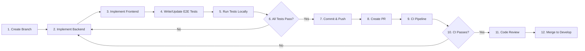

# Development Guide

> **Daily development workflow, coding standards, and project conventions**

---

## 📋 Table of Contents
- [Project Structure](#-project-structure)
- [Development Workflow](#-development-workflow)
- [Backend Conventions](#-backend-conventions)
- [Frontend Conventions](#-frontend-conventions)
- [E2E Test Conventions](#-e2e-test-conventions)
- [Database & Migrations](#-database--migrations)
- [Git Workflow](#-git-workflow)
- [Code Review](#-code-review)

---

## 📁 Project Structure

```
money-keeper/
├── backend/                          # Spring Boot (Java 17+)
│   ├── src/
│   │   ├── main/java/com/personal/money/management/core/
│   │   │   ├── account/              # Account bounded context
│   │   │   ├── category/             # Category bounded context
│   │   │   ├── tax/                  # Tax bounded context
│   │   │   ├── transaction/          # Transaction bounded context
│   │   │   ├── exchange/             # Exchange bounded context
│   │   │   └── settings/             # Settings bounded context
│   │   ├── main/resources/
│   │   │   ├── db/migration/h2/      # H2 Flyway migrations
│   │   │   ├── db/migration/oracle/  # Oracle Flyway migrations
│   │   │   ├── application.properties
│   │   │   ├── application-local.properties
│   │   │   └── application-ci.properties
│   │   └── test/                     # JUnit 5 tests
│   └── pom.xml
│
├── frontend/                         # Vue 3 + Vite + TypeScript
│   ├── src/
│   │   ├── api/                      # Axios API clients
│   │   ├── components/               # Reusable UI components
│   │   ├── views/                    # Page views
│   │   ├── stores/                   # Pinia stores
│   │   ├── router/                   # Vue Router
│   │   └── types/                    # TypeScript types
│   ├── package.json
│   ├── vite.config.ts
│   └── tsconfig.json
│
├── e2e/                              # Playwright + Cucumber
│   ├── features/                     # Gherkin feature files
│   ├── pages/                        # Page Objects
│   ├── actions/                      # Business workflow actions
│   ├── steps/                        # Step definitions
│   ├── assertions/                   # Business verifications
│   ├── fixtures/                     # Test fixtures
│   ├── test-data/                    # Test data factories
│   ├── helpers/                      # Utility functions
│   ├── tests/                        # Test runner config
│   └── playwright.config.ts
│
├── playwright-code-gen/              # Test code generation
│   ├── src/
│   ├── rules/                        # Conversion rules
│   └── tests/
│
├── k8s/                              # Helm chart
│   ├── Chart.yaml
│   ├── values.yaml
│   └── templates/
│
├── scripts/                          # Automation scripts
│   ├── deploy.sh
│   ├── start_backend.sh
│   ├── start_frontend.sh
│   └── run_e2e.sh
│
├── .github/
│   ├── workflows/                    # GitHub Actions
│   ├── actions/                      # Composite actions
│   └── agents/                       # AI agent definitions
│
└── docs/                             # Project documentation
```

---

## 🔄 Development Workflow

### Feature Development Cycle



### Step-by-Step

1. **Branch Creation**
   ```bash
   git checkout develop
   git pull
   git checkout -b feature/your-feature-name
   ```

2. **Implement Backend**
   - Create/update domain entities
   - Implement service logic
   - Add/update REST endpoints
   - Write unit + integration tests
   - ```bash
     cd backend && mvn test -P unit-test
     ```

3. **Implement Frontend**
   - Create/update Vue components
   - Add API calls to service layer
   - Update Pinia stores
   - ```bash
     cd frontend && npm run dev
     ```

4. **Write/Update E2E Tests**
   - Update Gherkin features if needed
   - Add/update step definitions
   - Run E2E tests
   - ```bash
     cd e2e && npm test
     ```

5. **Run All Tests Locally**
   ```bash
   # Backend
   cd backend && mvn verify
   
   # Frontend lint
   cd frontend && npm run lint
   
   # E2E
   cd e2e && npm test
   ```

6. **Commit & Push**
   ```bash
   git add .
   git commit -m "feat: add your feature description"
   git push origin feature/your-feature-name
   ```

7. **Create Pull Request**
   - Target branch: `develop`
   - Use conventional commit format in title
   - Include description of changes

---

## ☕ Backend Conventions

### Architecture Pattern
```
Controller → Service → Repository → Database
```

### Bounded Contexts
Each domain is a bounded context with its own package:
```
com.personal.money.management.core
├── account/
│   ├── AccountController.java
│   ├── AccountService.java
│   ├── AccountRepository.java
│   ├── Account.java              # Entity
│   └── dto/                      # DTOs
├── category/
├── transaction/
├── tax/
├── exchange/
└── settings/
```

### Coding Standards
- **Java**: 17+, use records for DTOs, `var` for local variables
- **Packages**: Organized by bounded context (DDD)
- **Controllers**: Thin, delegate to services
- **Services**: Business logic, `@Transactional` where needed
- **Repositories**: Spring Data JPA, custom queries with `@Query`
- **DTOs**: Use for API request/response, separate from entities
- **Validation**: `@Valid` on request bodies, custom validators
- **Exceptions**: Use `@ControllerAdvice` for global handling

### Testing Standards
- **Unit Tests**: JUnit 5 + Mockito, no Spring context
- **Integration Tests**: `@SpringBootTest` + Testcontainers or Oracle
- **Coverage**: JaCoCo, minimum 80% line coverage
- **Test Profiles**: `unit-test`, `integration-test` Maven profiles

### Maven Profiles
```bash
# Unit tests only
mvn test -P unit-test

# Integration tests (requires Docker)
mvn test -P integration-test

# All tests
mvn verify

# Sonar analysis
mvn verify -P sonar -Dsonar.token=$SONAR_TOKEN
```

---

## 🖥️ Frontend Conventions

### Architecture Pattern
```
View (Page) → Store (State) → API (Service) → Backend
```

### Key Technologies
| Library | Purpose |
|---------|---------|
| Vue 3 | Framework (Composition API) |
| Vite | Build tool |
| TypeScript | Language |
| Pinia | State management |
| Vue Router | Client-side routing |
| Axios | HTTP client |
| Element Plus | UI component library |

### Code Organization
```typescript
src/
├── api/                    # Axios API modules
│   ├── accountApi.ts
│   ├── categoryApi.ts
│   └── transactionApi.ts
├── components/             # Reusable UI components
│   ├── common/             # Shared components
│   └── forms/              # Form components
├── views/                  # Page-level components
│   ├── accounts/
│   ├── categories/
│   └── transactions/
├── stores/                 # Pinia state stores
│   ├── accountStore.ts
│   ├── categoryStore.ts
│   └── transactionStore.ts
├── router/                 # Route definitions
│   └── index.ts
└── types/                  # TypeScript interfaces
    ├── account.ts
    └── category.ts
```

### Coding Standards
- **Language**: TypeScript strict mode
- **State Management**: Pinia with Composition API style
- **Components**: Small, focused, reusable
- **API Calls**: Centralized in `api/` modules
- **Forms**: Element Plus components with validation
- **Styling**: Scoped CSS, responsive design
- **Error Handling**: Axios interceptors for global error handling

---

## 🧪 E2E Test Conventions

### Architecture Pattern
```
Feature (Gherkin) → Step Definition → Action → Page Object → Playwright
```

### Test Organization
```
e2e/
├── features/               # Gherkin feature files (*.feature)
│   └── accounts/           # Domain-organized
├── pages/                  # Page Objects
│   └── accounts/
│       ├── AccountListPage.ts
│       └── AccountFormPage.ts
├── actions/                # Business workflows
│   └── accounts/
│       └── AccountActions.ts
├── steps/                  # Step definitions
│   └── accounts/
│       └── AccountSteps.ts
├── assertions/             # Verification logic
├── fixtures/               # Test data + hooks
├── test-data/              # Data factories
└── helpers/                # Utilities
```

### Writing Tests
```gherkin
# Example feature: accounts/manage_accounts.feature
Feature: Manage Accounts

  Scenario: Create a new bank account
    Given I am on the accounts page
    When I create an account with:
      | name   | type | balance |
      | My Bank | Bank | 1000000 |
    Then I should see the account "My Bank" in the list
```

```typescript
// Step definition
Given('I am on the accounts page', async () => {
  await accountActions.navigateToAccountsPage();
});

When('I create an account with:', async (table: DataTable) => {
  await accountActions.createAccount(table.rowsHash());
});

Then('I should see the account {string} in the list', async (name: string) => {
  await accountActions.verifyAccountExists(name);
});
```

### Running E2E Tests
```bash
# All tests
cd e2e && npm test

# Specific feature
cd e2e && npx cucumber-js features/accounts/

# With Playwright UI mode
cd e2e && npx playwright test --ui
```

---

## 🗄️ Database & Migrations

### Database Strategy
| Environment | Database | Profile | Setup |
|-------------|----------|---------|-------|
| Local Dev | H2 (in-memory) | `local` | None needed |
| CI | Oracle | `ci` | Docker Compose |
| Production | Oracle | — | Managed via Flyway |

### Migration Files

**H2 (local development):**
```
backend/src/main/resources/db/migration/h2/
├── V1__init.sql
├── V2__add_categories.sql
├── V4__add_transactions.sql
└── V5__add_tax_tables.sql
```

**Oracle (CI/Production):**
```
backend/src/main/resources/db/migration/oracle/
├── V0__create_core_user.sql          # Creates CORE schema
├── V1__init.sql
├── V2__add_categories.sql
├── V4__add_transactions.sql
└── V5__add_tax_tables.sql
```

### Migration Rules
- Version numbers must be consistent between H2 and Oracle
- Oracle has an additional `V0__create_core_user.sql`
- No migration version 3 exists (intentional gap)
- Migrations should be reversible (include `DROP` statements)
- Test both H2 and Oracle migrations locally

---

## 🌿 Git Workflow

### Branch Strategy
```
master/                     # Production-ready code
  └── develop/              # Integration branch
        ├── feature/*       # New features
        ├── bugfix/*        # Bug fixes
        ├── hotfix/*        # Production hotfixes (to master)
        └── release/*       # Release preparation
```

### Commit Convention (Conventional Commits)
```
feat: add account creation form        # New feature
fix: resolve category delete bug       # Bug fix
refactor: extract tax calculation      # Code refactoring
test: add E2E for account flow         # Test updates
docs: update API documentation         # Documentation
chore: update Maven dependencies       # Maintenance
ci: optimize GitHub Actions cache      # CI/CD changes
```

### PR Requirements
- Title follows conventional commits: `feat: description`
- All CI checks pass (unit, integration, analysis, E2E)
- At least one reviewer approves
- No merge conflicts with target branch
- Branch is up to date with `develop`

---

## 👀 Code Review

### Checklist for Reviewers

**Backend:**
- [ ] Follows DDD bounded context structure?
- [ ] Proper use of `@Transactional`?
- [ ] API follows REST conventions?
- [ ] Tests cover happy path + edge cases?
- [ ] No N+1 query problems?
- [ ] Proper error handling?

**Frontend:**
- [ ] Uses Composition API?
- [ ] TypeScript types defined?
- [ ] Pinia store properly structured?
- [ ] API calls in `api/` module?
- [ ] Form validation implemented?
- [ ] Responsive design?

**E2E Tests:**
- [ ] Gherkin scenarios readable?
- [ ] Step definitions delegate to actions?
- [ ] Page objects have proper locators?
- [ ] Test data properly isolated?
- [ ] No hardcoded values?

**General:**
- [ ] No secrets or hardcoded passwords?
- [ ] No TODO without ticket reference?
- [ ] Documentation updated if needed?
- [ ] Migration versions consistent?

---

## 🛠️ Useful Commands

```bash
# === Backend ===
mvn clean install -DskipTests    # Build without tests
mvn test -P unit-test            # Unit tests only
mvn test -P integration-test     # Integration tests
mvn verify                       # All tests
mvn spring-boot:run              # Start server (local profile)
mvn spring-boot:run -Dspring-boot.run.profiles=ci  # Start with CI profile

# === Frontend ===
npm install                      # Install dependencies
npm run dev                      # Dev server
npm run build                    # Production build
npm run lint                     # ESLint
npm run lint:fix                 # Auto-fix lint issues

# === E2E ===
npm test                         # Run all E2E tests
npx cucumber-js features/        # Run specific features
npx playwright show-report       # View last test report
npx playwright --ui              # UI mode

# === Database ===
docker-compose up -d oracle flyway  # Start DB + migrations
docker-compose down              # Stop all services
docker logs money-keeper-oracle  # View DB logs
```

---

> **Last Updated**: 2026-07-16  
> **See also**: [Architecture](architecture.md), [Testing Strategy](TESTING_STRATEGY.md), [Getting Started](GETTING_STARTED.md)