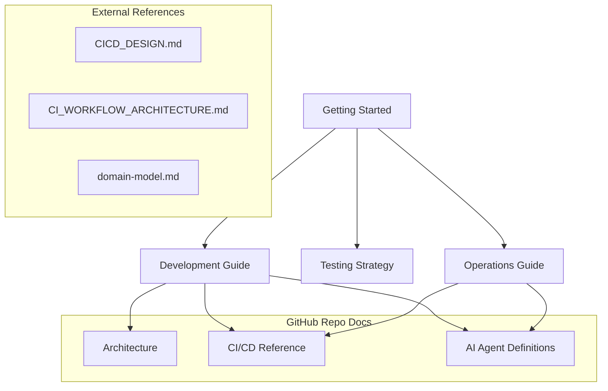

# Money Keeper — Documentation Index

> **Full-stack personal finance management application**  
> Backend: Spring Boot (Java) · Frontend: Vue 3 (TypeScript) · E2E: Playwright + Cucumber  
> Infrastructure: Docker · Kubernetes (GKE) · Helm · GitHub Actions

---

## 🚀 Quick Access

| Document | Audience | Description |
|----------|----------|-------------|
| [Getting Started](GETTING_STARTED.md) | Everyone | First-time setup, prerequisites, running the app |
| [Development Guide](DEVELOPMENT_GUIDE.md) | Developers | Daily development workflow, coding standards, architecture |
| [Operations Guide](OPERATIONS_GUIDE.md) | DevOps | Deployment, infrastructure, monitoring |
| [CI/CD Reference](CI_CD_REFERENCE.md) | DevOps | Complete pipeline documentation |
| [Testing Strategy](TESTING_STRATEGY.md) | QA/Dev | Test pyramid, E2E architecture, best practices |
| [Architecture](architecture.md) | Everyone | System architecture overview |

---

## 📋 Documentation Map



## 📚 Documentation Set

### 🏁 Onboarding
| Document | Contents |
|----------|----------|
| [Getting Started](GETTING_STARTED.md) | Prerequisites, environment setup, first run, troubleshooting |

### 🛠 Development
| Document | Contents |
|----------|----------|
| [Development Guide](DEVELOPMENT_GUIDE.md) | Project structure, coding standards, backend/frontend conventions, local workflow |
| [Architecture](architecture.md) | System architecture, domain model, data flow |
| [Domain Model](domain-model.md) | Core entities, relationships, business rules |
| [ADR-002 Anti-Corruption Layer](ADR-002-ANTI-CORRUPTION-LAYER.md) | Architecture Decision Record for ACL pattern |
| [ADR-003 Aggregate Root Boundaries](ADR-003-AGGREGATE-ROOT-BOUNDARIES.md) | Architecture Decision Record for aggregate design |
| [Aggregate Roots Pattern](AGGREGATE_ROOTS_PATTERN.md) | Detailed aggregate root implementation guide |
| [Anti-Corruption Layer Pattern](ANTI_CORRUPTION_LAYER_PATTERN.md) | Detailed ACL implementation guide |
| [Repository Map](repository-map.md) | Codebase navigational map |

### 🧪 Testing
| Document | Contents |
|----------|----------|
| [Testing Strategy](TESTING_STRATEGY.md) | Full testing pyramid, tools, patterns, best practices |
| [Automation Architecture](automation-architecture.md) | E2E test architecture details |
| [Agent Task Guidelines](AGENT_TASK_GUIDELINES.md) | Guidelines for AI agents writing tests |

### 🚢 DevOps / CI/CD
| Document | Contents |
|----------|----------|
| [Operations Guide](OPERATIONS_GUIDE.md) | Infrastructure, deployment, monitoring, troubleshooting |
| [CI/CD Reference](CI_CD_REFERENCE.md) | Pipeline architecture, workflows, actions, secrets |
| [CI Workflow Architecture](CI_WORKFLOW_ARCHITECTURE.md) | Detailed CI design & principles |
| [CI/CD Design](CICD_DESIGN.md) | Original CI/CD design document |

### 🤖 AI Agents
| Document | Contents |
|----------|----------|
| [`ci-cd.agent.md`](../.github/agents/ci-cd.agent.md) | DevOps engineer agent definition |
| [`money-keeper.agent.md`](../.github/agents/money-keeper.agent.md) | Full-stack engineer agent definition |
| [`agent-prompts.md`](agent-prompts.md) | AI agent prompting strategies |
| [`ai-task-examples.md`](ai-task-examples.md) | Example AI-powered development tasks |
| [`AGENT_TASK_GUIDELINES.md`](AGENT_TASK_GUIDELINES.md) | Guidelines for working with AI agents |

---

## 🔗 Quick Links

### GitHub Resources
- [Workflows](../.github/workflows/) — All CI/CD workflow definitions
- [Actions](../.github/actions/) — All composite action definitions
- [Agents](../.github/agents/) — AI agent definitions
- [Helm Charts](../k8s/) — Kubernetes deployment charts

### Source Code
- [Backend](../backend/) — Spring Boot application
- [Frontend](../frontend/) — Vue 3 application
- [E2E Tests](../e2e/) — Playwright + Cucumber test suite
- [Playwright Code Gen](../playwright-code-gen/) — Test code generation utilities

### Configuration
- [Docker Compose](../docker-compose.yml) — Local development stack
- [Backend Config](../backend/src/main/resources/) — Application properties
- [Frontend Config](../frontend/.env.development) — Environment variables

---

## 📦 Project Tech Stack

```
┌──────────────────────────────────────────────────────┐
│                    Frontend                          │
│  Vue 3 · TypeScript · Vite · Element Plus · Pinia   │
├──────────────────────────────────────────────────────┤
│                    Backend                           │
│  Spring Boot (Java 17+) · Maven · Flyway · Oracle/H2 │
├──────────────────────────────────────────────────────┤
│                    Testing                           │
│  JUnit 5 · JaCoCo · Playwright · Cucumber · Allure   │
├──────────────────────────────────────────────────────┤
│                 Infrastructure                       │
│  Docker · Docker Compose · Kubernetes (GKE) · Helm   │
├──────────────────────────────────────────────────────┤
│                   CI/CD                              │
│  GitHub Actions · SonarCloud · GHCR · ngrok          │
└──────────────────────────────────────────────────────┘
```

---

> **Maintainers**: Update this index when adding new documentation.  
> **Last Updated**: 2026-07-16