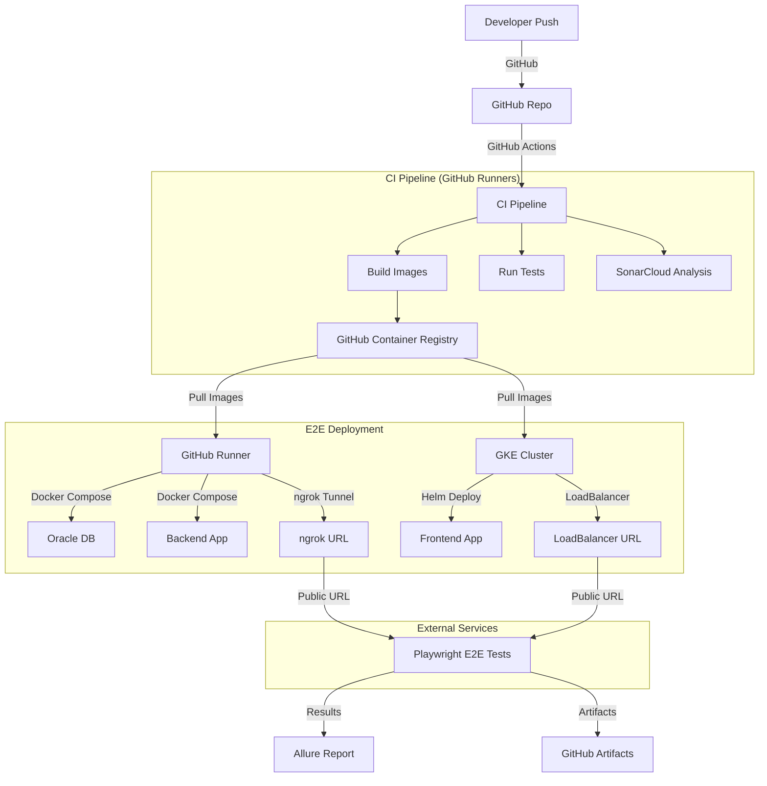
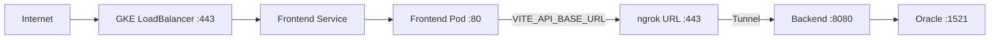
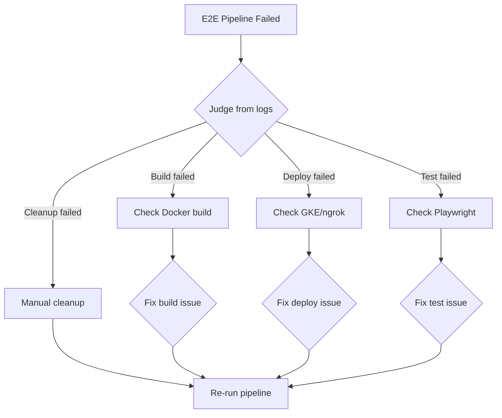

# Operations Guide

> **Infrastructure, deployment, monitoring, and troubleshooting for production operations**

---

## 📋 Table of Contents
- [Infrastructure Overview](#-infrastructure-overview)
- [GKE Cluster Management](#-gke-cluster-management)
- [Helm Deployments](#-helm-deployments)
- [Docker Image Management](#-docker-image-management)
- [CI/CD Pipeline Operations](#-cicd-pipeline-operations)
- [Monitoring & Logging](#-monitoring--logging)
- [Disaster Recovery](#-disaster-recovery)
- [Troubleshooting](#-troubleshooting)

---

## 🏗️ Infrastructure Overview

### Architecture Diagram



### Components

| Component | Location | Purpose | Scaling |
|-----------|----------|---------|---------|
| **GKE Cluster** | GCP | Frontend hosting | Node auto-scaling |
| **GitHub Runners** | GitHub-hosted | CI/CD execution | Job-level parallel |
| **GitHub Container Registry** | ghcr.io | Docker image storage | Managed |
| **Oracle DB** | Docker container | Backend database | Single instance (CI) |
| **SonarCloud** | SaaS | Code quality analysis | Managed |
| **ngrok** | SaaS | Local tunnel for E2E | Single tunnel |
| **GitHub Pages** | GitHub | Allure test reports | Managed |

### Network Architecture



---

## ☸️ GKE Cluster Management

### Cluster Setup

**Prerequisites:**
- Google Cloud Platform project
- `gcloud` CLI installed and authenticated
- `kubectl` installed
- `helm` installed

**Creating a Cluster:**
```bash
# Set variables
export PROJECT_ID="your-project-id"
export CLUSTER_NAME="money-keeper-cluster"
export ZONE="us-central1-a"

# Authenticate
gcloud auth login
gcloud config set project $PROJECT_ID

# Enable required APIs
gcloud services enable container.googleapis.com
gcloud services enable containerregistry.googleapis.com

# Create cluster
gcloud container clusters create $CLUSTER_NAME \
  --zone $ZONE \
  --num-nodes 2 \
  --machine-type e2-medium \
  --enable-autoscaling \
  --min-nodes 1 \
  --max-nodes 5 \
  --release-channel regular

# Get credentials
gcloud container clusters get-credentials $CLUSTER_NAME --zone $ZONE
```

**Useful Commands:**
```bash
# List clusters
gcloud container clusters list

# Scale cluster
gcloud container clusters resize $CLUSTER_NAME --num-nodes=3 --zone=$ZONE

# View nodes
kubectl get nodes

# View pods in all namespaces
kubectl get pods --all-namespaces

# Describe a problematic pod
kubectl describe pod <pod-name>

# View pod logs
kubectl logs -f <pod-name>

# Restart deployment
kubectl rollout restart deployment <deployment-name>
```

### Service Account Setup
```bash
# Create service account
gcloud iam service-accounts create money-keeper-sa \
  --display-name="Money Keeper Service Account"

# Grant permissions
gcloud projects add-iam-policy-binding $PROJECT_ID \
  --member="serviceAccount:money-keeper-sa@$PROJECT_ID.iam.gserviceaccount.com" \
  --role="roles/container.admin"

gcloud projects add-iam-policy-binding $PROJECT_ID \
  --member="serviceAccount:money-keeper-sa@$PROJECT_ID.iam.gserviceaccount.com" \
  --role="roles/storage.admin"

# Create and download key
gcloud iam service-accounts keys create gcp-sa-key.json \
  --iam-account="money-keeper-sa@$PROJECT_ID.iam.gserviceaccount.com"
```

### Configure GitHub Actions with GCP
1. Copy contents of `gcp-sa-key.json`
2. Go to GitHub repo → Settings → Secrets → Actions
3. Add secret: `GCP_SA_KEY` = (full JSON content)
4. Add variables: `GKE_CLUSTER`, `GKE_ZONE`

---

## ⛵ Helm Deployments

### Chart Structure

```
k8s/
├── Chart.yaml                  # Helm chart metadata
├── values.yaml                 # Default configuration values
├── templates/
│   ├── frontend-deployment.yaml
│   ├── backend-deployment.yaml
│   ├── oracle-statefulset.yaml
│   ├── ingress.yaml
│   ├── flyway-job.yaml
│   ├── nginx-configmap.yaml
│   ├── github-secret.yaml
│   └── oracle-secret.yaml
├── local-setup/                # Local dev overrides
└── README.md
```

### Deploying Frontend

**Manual Deployment:**
```bash
# Navigate to helm chart
cd k8s

# Template and review
helm template money-keeper . \
  --set frontend.image.tag=latest \
  --set frontend.env.VITE_API_BASE_URL=https://your-ngrok-url

# Deploy
helm upgrade --install money-keeper . \
  --namespace default \
  --set frontend.image.repository=ghcr.io/samdofreelancer/money-keeper-frontend \
  --set frontend.image.tag=$IMAGE_TAG \
  --set frontend.env.VITE_API_BASE_URL=$BACKEND_URL

# Check deployment
kubectl get pods
kubectl get services
```

**CI/CD Deployment (from deploy-frontend.yml):**
```yaml
- name: Deploy with Helm
  run: |
    helm upgrade --install money-keeper ./k8s \
      --namespace default \
      --set frontend.image.repository=${{ env.REGISTRY }}/money-keeper-frontend \
      --set frontend.image.tag=${{ inputs.frontend_image }} \
      --set frontend.env.VITE_API_BASE_URL=${{ inputs.backend_url }}
```

### Exposing Frontend (LoadBalancer)
```bash
# Patch service to LoadBalancer
kubectl patch service money-keeper-frontend \
  -p '{"spec": {"type": "LoadBalancer"}}'

# Get external IP
kubectl get service money-keeper-frontend -w
```

### Cleaning Up
```bash
# Delete Helm release
helm uninstall money-keeper

# Or delete just the frontend deployment
kubectl delete deployment money-keeper-frontend
kubectl delete service money-keeper-frontend
```

---

## 🐳 Docker Image Management

### Image Registry
All images are stored in **GitHub Container Registry (GHCR)**:
```
ghcr.io/samdofreelancer/money-keeper-backend:sha-xxxxx
ghcr.io/samdofreelancer/money-keeper-frontend:sha-xxxxx
```

### Building Locally
```bash
# Backend
docker build -t money-keeper-backend:latest ./backend

# Frontend
docker build -t money-keeper-frontend:latest ./frontend
```

### CI Build (from build-images.yml)
```yaml
- name: Build and push backend
  uses: docker/build-push-action@v5
  with:
    context: ./backend
    push: true
    tags: ${{ env.REGISTRY }}/money-keeper-backend:${{ env.IMAGE_TAG }}
    cache-from: type=gha
    cache-to: type=gha,mode=max
```

### Manual Management
```bash
# List images
gh api /user/packages?package_type=container

# Delete old images (cleanup)
gh api --method DELETE /user/packages/container/money-keeper-backend/versions/$VERSION_ID
```

---

## ⚙️ CI/CD Pipeline Operations

### Available Workflows

| Workflow | File | Trigger | Duration |
|----------|------|---------|----------|
| **CI Pipeline** | `ci.yml` | Push/PR to develop/master | ~15 min |
| **E2E on GKE** | `e2e-gke.yml` | Manual (workflow_dispatch) | ~20 min |
| **Build Images** | `build-images.yml` | Called | ~5 min |
| **Deploy Backend** | `deploy-backend.yml` | Called | ~10 min |
| **Deploy Frontend** | `deploy-frontend.yml` | Called | ~5 min |
| **Run E2E** | `run-e2e.yml` | Called | ~10 min |
| **Cleanup** | `cleanup.yml` | Called | ~3 min |

### Running E2E on GKE Manually

```yaml
# In GitHub UI:
1. Actions → "E2E Test with Frontend on GKE and Backend on Runner"
2. Click "Run workflow"
3. Select branch (default: develop)
4. Click "Run workflow"

# Monitor progress:
- build-images → deploy-backend + deploy-frontend → run-e2e → cleanup
```

### Secrets Management

**Required Secrets:**
```
Name: GCP_SA_KEY
Value: (JSON key for GCP service account)
Usage: GCP authentication for GKE

Name: ORACLE_PASSWORD_SECRET
Value: (Oracle DB password)
Usage: Backend database connection

Name: NGROK_AUTH_TOKEN
Value: (ngrok auth token)
Usage: Expose local backend via tunnel

Name: SONAR_TOKEN
Value: (SonarCloud token) — OPTIONAL
Usage: SonarCloud code analysis
```

**Required Variables:**
```
Name: GKE_CLUSTER
Value: money-keeper-cluster

Name: GKE_ZONE
Value: us-central1-a

Name: SONAR_PROJECT_KEY
Value: (SonarCloud project key) — OPTIONAL

Name: SONAR_ORGANIZATION
Value: (SonarCloud org) — OPTIONAL
```

---

## 📊 Monitoring & Logging

### GitHub Actions Monitoring

**Check Pipeline Health:**
1. Go to GitHub repo → Actions tab
2. Review workflow run history
3. Check success/failure rates
4. Review execution times for trends

**Debugging Failed Runs:**
```bash
# Download artifacts from failed run
# Check:
- Surefire test reports (*.xml)
- Playwright trace/viewer reports
- Screenshots on failure
- Allure HTML reports
```

### GKE Monitoring

**Basic Monitoring:**
```bash
# Check pod status
kubectl get pods -o wide

# Check pod logs
kubectl logs -f deployment/money-keeper-frontend

# Check resource usage
kubectl top pods
kubectl top nodes

# Check events
kubectl get events --sort-by='.lastTimestamp'
```

**GCP Monitoring (Console):**
- GKE → Workloads → Check deployment health
- GKE → Services & Ingress → Check endpoints
- Cloud Monitoring → Dashboards → GKE
- Cloud Logging → Query logs by resource

### Allure Test Reports

After E2E pipeline completes, Allure reports are published to GitHub Pages:
```
https://samdofreelancer.github.io/money-keeper/
```

---

## 🔄 Disaster Recovery

### Pipeline Failure Recovery

| Failure | Immediate Action | Root Cause Fix |
|---------|-----------------|----------------|
| GCP auth fails | Re-run with fresh SA key | Regenerate key, verify roles |
| Oracle not starting | Increase timeout | Check Docker image, port conflicts |
| K8s deploy fails | Clean up, re-deploy | Verify Helm values, cluster state |
| ngrok fails | Check token, re-tunnel | Regenerate ngrok token |
| Tests fail | Fix test code | Review Playwright traces |

### Cleanup Procedures

**If pipeline is stuck mid-way:**
```bash
# Stop Docker containers
docker-compose down
docker stop $(docker ps -q) 2>/dev/null

# Delete GKE resources
kubectl delete deployment money-keeper-frontend --ignore-not-found
kubectl delete service money-keeper-frontend --ignore-not-found
kubectl delete deployment money-keeper-backend --ignore-not-found

# Or force cleanup by running cleanup.yml manually
# GitHub Actions → cleanup.yml → Run workflow
```

### Rollback Strategy

**Frontend Rollback (GKE):**
```bash
# Rollback to previous Helm revision
helm rollback money-keeper 1

# Or deploy a specific older image
helm upgrade --install money-keeper ./k8s \
  --set frontend.image.tag=previous-stable-tag
```

**Backend Rollback:**
```bash
# Stop current, start previous Docker image
docker stop money-keeper-backend
docker run -d --name money-keeper-backend \
  -p 8080:8080 \
  ghcr.io/samdofreelancer/money-keeper-backend:previous-tag
```

---

## 🐛 Troubleshooting

### Quick Reference

| Symptom | Diagnosis Command | Fix |
|---------|------------------|-----|
| Frontend not loading | `kubectl get pods` | Check pod status, logs |
| Backend 502 errors | `curl http://localhost:8080/actuator/health` | Check backend logs |
| Database connection failed | `docker logs money-keeper-oracle` | Check Oracle started |
| ngrok tunnel down | Check `NGROK_AUTH_TOKEN` | Check ngrok status page |
| GKE deployment stuck | `kubectl describe pod <pod>` | Check events for errors |
| CI timeout | Check workflow logs | Increase `timeout-minutes` |
| npm install slow | Check cache hit rate | Verify `package-lock.json` |

### Common Errors & Solutions

**"ImagePullBackOff" on GKE:**
```bash
# Problem: Can't pull from GHCR
# Solution: Ensure imagePullSecrets is configured
kubectl delete secret ghcr-secret
kubectl create secret docker-registry ghcr-secret \
  --docker-server=ghcr.io \
  --docker-username=$GITHUB_USER \
  --docker-password=$GITHUB_TOKEN
```

**"CrashLoopBackOff" on GKE:**
```bash
# Check logs
kubectl logs -f <pod-name> --previous

# Common causes:
# - Wrong environment variable
# - Backend URL not accessible from frontend pod
# - Memory/CPU limits too low
```

**"STATUS: Terminated" in ngrok:**
```bash
# Common: ngrok session expired
# Fix: Restart ngrok tunnel
# Check: NGROK_AUTH_TOKEN is still valid
# Alternative: Use ngrok static domain if available
```

**SonarCloud Analysis Failing:**
```bash
# Problem: Can't find JaCoCo reports
# Fix: Ensure artifact names match contract
# Check: jacoco-report-unit and jacoco-report-integration exist
# Check: merge-jacoco-reports action ran successfully
```

---

## 📋 Runbooks

### Runbook: Full E2E Pipeline Failure



### Runbook: GKE Cluster Unhealthy

1. **Check cluster status:**
   ```bash
   gcloud container clusters describe $CLUSTER_NAME --zone $ZONE
   kubectl cluster-info
   ```

2. **Check node health:**
   ```bash
   kubectl get nodes -o wide
   kubectl describe nodes | grep -A 5 Conditions
   ```

3. **Check pod health:**
   ```bash
   kubectl get pods --all-namespaces -o wide | grep -v Running
   ```

4. **Restart if needed:**
   ```bash
   kubectl rollout restart deployment/money-keeper-frontend
   kubectl delete pod <unhealthy-pod> --force
   ```

---

## 🔐 Security

### Secrets Rotation

| Secret | Rotation Frequency | Impact of Compromise |
|--------|-------------------|---------------------|
| GCP_SA_KEY | Every 90 days | Full GKE access |
| ORACLE_PASSWORD_SECRET | Every 90 days | Database access |
| NGROK_AUTH_TOKEN | Every 30 days | Tunnel hijacking |
| SONAR_TOKEN | Every 180 days | Code analysis access |

### Access Control

**GitHub Repository:**
- `main`/`master`: Protected branch, requires PR + review
- `develop`: Protected branch, requires CI pass
- Actions: Only on PR from same repo

**GCP IAM:**
- Service account has minimum required roles
- No direct user access to GKE (GitHub Actions only)
- Key restricted to GitHub Secrets

---

> **Last Updated**: 2026-07-16  
> **See also**: [CI/CD Reference](CI_CD_REFERENCE.md), [Getting Started](GETTING_STARTED.md), [Architecture](architecture.md)