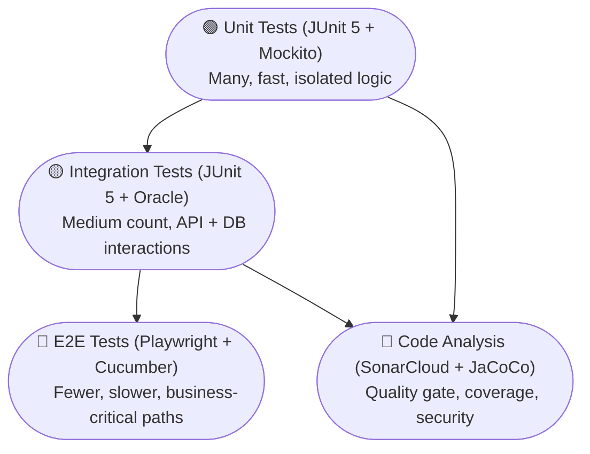
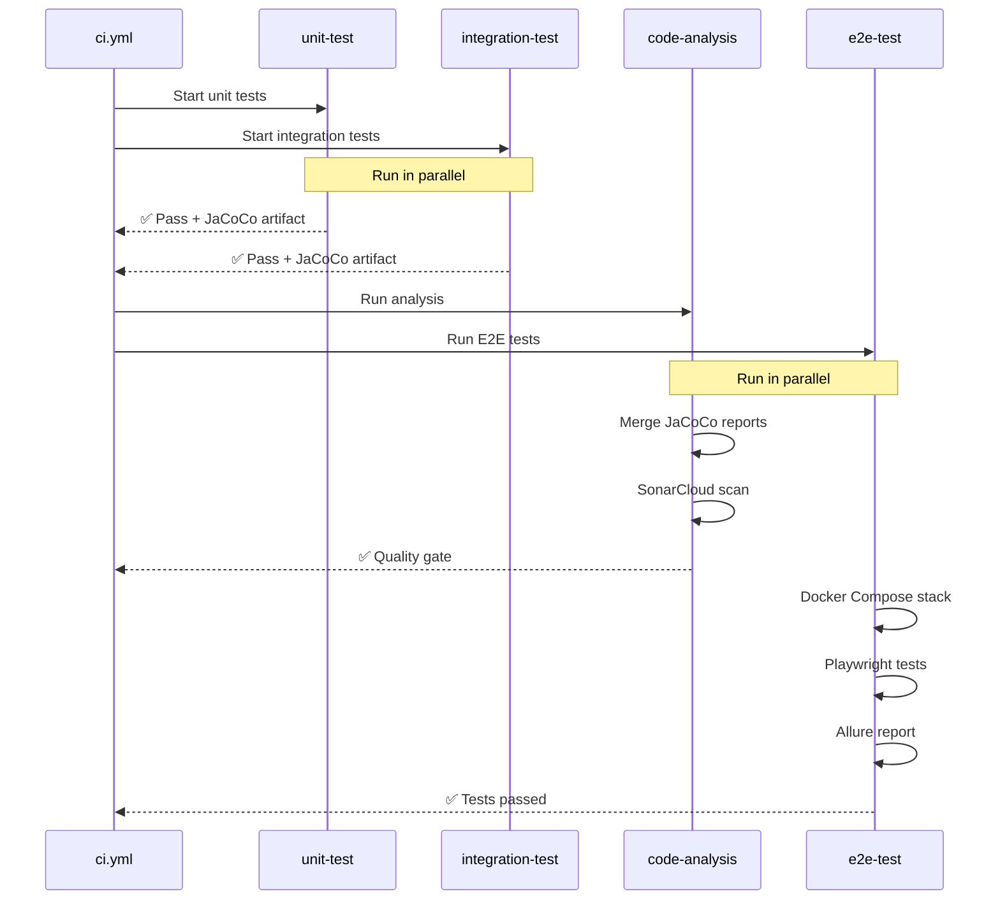

# Testing Strategy

> **Multi-layered testing approach: Unit → Integration → E2E → Code Analysis**

---

## 📋 Table of Contents
- [Test Pyramid](#-test-pyramid)
- [Test Layers](#-test-layers)
- [Backend Testing](#-backend-testing)
- [E2E Testing (Playwright + Cucumber)](#-e2e-testing-playwright--cucumber)
- [Code Analysis & Quality Gates](#-code-analysis--quality-gates)
- [Test Data Management](#-test-data-management)
- [CI Integration](#-ci-integration)
- [Best Practices](#-best-practices)

---

## 🏔️ Test Pyramid



### Distribution Goals
| Layer | Count | Speed | Run Frequency | Coverage Target |
|-------|-------|-------|---------------|-----------------|
| Unit | 80%+ | ms | Every commit | 85%+ line coverage |
| Integration | 15% | seconds | Every commit | Key paths |
| E2E | 5% | minutes | After tests pass | Critical flows |
| Code Analysis | — | minutes | After tests | Quality gate pass |

---

## 🧪 Test Layers

### 1. Unit Tests — JUnit 5 + Mockito
**Profile:** `unit-test`  
**Location:** `backend/src/test/`  
**Runner:** `mvn test -P unit-test`

**Scope:**
- Service layer business logic
- Domain entity validation
- Repository custom queries (with `@DataJpaTest`)
- Utility/helper methods
- DTO mapping/validation

**Pattern:**
```java
@ExtendWith(MockitoExtension.class)
class AccountServiceTest {

    @Mock
    private AccountRepository accountRepository;

    @InjectMocks
    private AccountService accountService;

    @Test
    void shouldCreateAccountSuccessfully() {
        // Given
        CreateAccountRequest request = new CreateAccountRequest("Bank", "Bank", 1000L);

        // When
        Account result = accountService.create(request);

        // Then
        assertThat(result.getName()).isEqualTo("Bank");
        verify(accountRepository).save(any(Account.class));
    }

    @Test
    void shouldThrowExceptionWhenNameAlreadyExists() {
        // Given
        when(accountRepository.existsByName("Bank")).thenReturn(true);

        // Then
        assertThrows(DuplicateAccountException.class, () -> {
            accountService.create(new CreateAccountRequest("Bank", "Bank", 0L));
        });
    }
}
```

### 2. Integration Tests — JUnit 5 + Spring Boot
**Profile:** `integration-test`  
**Location:** `backend/src/test/`  
**Runner:** `mvn test -P integration-test` (requires Docker)

**Scope:**
- Full REST endpoint behavior
- Database read/write operations
- Transactional boundaries
- Flyway migration correctness
- Cross-service orchestration

**Pattern:**
```java
@SpringBootTest(webEnvironment = WebEnvironment.RANDOM_PORT)
@ActiveProfiles("ci")
@Testcontainers
class AccountControllerIntegrationTest {

    @Autowired
    private TestRestTemplate restTemplate;

    @Test
    void shouldCreateAndRetrieveAccount() {
        // Create
        var request = new CreateAccountRequest("Integration-Bank", "Bank", 500000L);
        var createResponse = restTemplate.postForEntity("/api/accounts", request, AccountDTO.class);
        assertThat(createResponse.getStatusCode()).isEqualTo(HttpStatus.CREATED);

        // Retrieve
        var id = createResponse.getBody().getId();
        var getResponse = restTemplate.getForEntity("/api/accounts/" + id, AccountDTO.class);
        assertThat(getResponse.getBody().getName()).isEqualTo("Integration-Bank");
    }
}
```

### 3. E2E Tests — Playwright + Cucumber
**Location:** `e2e/` | `playwright-code-gen/`  
**Runner:** `cd e2e && npm test` (requires backend + frontend)

**Scope:**
- Full user journey scenarios
- Cross-cutting features (login, CRUD flows)
- UI interactions and data display
- Error states and edge cases

**Architecture:**
```
Feature (Gherkin) → Step Definition → Action → Page Object → Playwright
```

**Feature File (Gherkin):**
```gherkin
Feature: Account Management

  Background:
    Given I am logged into the application

  Scenario: Create a new bank account
    When I navigate to the accounts page
    And I click "Add Account"
    And I fill in the account form with:
      | field  | value      |
      | name   | My Bank    |
      | type   | Bank       |
      | balance| 1000000    |
    And I submit the form
    Then I should see "My Bank" in the account list

  Scenario: Account name uniqueness is enforced
    Given an account named "Duplicate" exists
    When I try to create an account named "Duplicate"
    Then I should see an error "Account name already exists"
```

**Step Definition (TypeScript):**
```typescript
import { Given, When, Then } from '@cucumber/cucumber';
import { accountActions } from '../../actions/accounts/AccountActions';

Given('I am logged into the application', async function () {
  await loginActions.loginAsDefaultUser();
});

When('I navigate to the accounts page', async function () {
  await accountActions.navigateToAccountsPage();
});

When('I click {string}', async function (buttonText: string) {
  await accountActions.clickButton(buttonText);
});

When('I fill in the account form with:', async function (table: DataTable) {
  await accountActions.fillAccountForm(table.rowsHash());
});

Then('I should see {string} in the account list', async function (name: string) {
  await accountActions.verifyAccountInList(name);
});
```

**Action (Business Workflow):**
```typescript
export class AccountActions {
  async navigateToAccountsPage() {
    await this.accountListPage.navigate();
    await this.accountListPage.waitForPageLoad();
  }

  async createAccount(data: Record<string, string>) {
    await this.accountListPage.clickAddAccount();
    await this.accountFormPage.fillForm(data);
    await this.accountFormPage.submit();
    await this.accountListPage.waitForAccountToAppear(data.name);
  }

  async verifyAccountInList(name: string) {
    await expect(this.accountListPage.getAccountRow(name)).toBeVisible();
  }
}
```

**Page Object (Playwright):**
```typescript
export class AccountListPage {
  constructor(private page: Page) {}

  async navigate() {
    await this.page.goto('/accounts');
  }

  async clickAddAccount() {
    await this.page.getByRole('button', { name: 'Add Account' }).click();
  }

  getAccountRow(name: string) {
    return this.page.getByRole('row').filter({ hasText: name });
  }

  async waitForAccountToAppear(name: string) {
    await this.page.waitForSelector(`text=${name}`);
  }
}
```

---

## 🧪 Backend Testing

### Maven Profiles
| Profile | Command | Tests | Database | Docker Required |
|---------|---------|-------|----------|-----------------|
| `unit-test` | `mvn test -P unit-test` | Unit | None (Mockito) | No |
| `integration-test` | `mvn test -P integration-test` | Integration | Oracle | Yes |
| `sonar` | `mvn verify -P sonar` | All | Both | Yes (IT) |
| *(default)* | `mvn verify` | All | Both | Yes (IT) |

### JaCoCo Coverage Configuration
```xml
<plugin>
    <groupId>org.jacoco</groupId>
    <artifactId>jacoco-maven-plugin</artifactId>
    <version>0.8.11</version>
    <configuration>
        <excludes>
            <exclude>**/dto/**</exclude>
            <exclude>**/config/**</exclude>
            <exclude>**/*Application.*</exclude>
        </excludes>
    </configuration>
</plugin>
```

### Report Aggregation
Unit + Integration JaCoCo reports are merged before Sonar analysis:
```
unit-test.yml          integration-test.yml
    │                        │
    │   jacoco-report-unit   │   jacoco-report-integration
    │                        │
    └──────────┬─────────────┘
               │
        merge-jacoco-reports
               │
        code-analysis.yml (SonarCloud)
```

---

## 🧪 E2E Testing (Playwright + Cucumber)

### Test Organization

```
e2e/
├── features/               # Gherkin feature files
│   ├── accounts/
│   │   └── manage_accounts.feature
│   ├── categories/
│   ├── transactions/
│   └── tax/
├── pages/                  # Page Objects
│   ├── accounts/
│   │   ├── AccountListPage.ts
│   │   └── AccountFormPage.ts
│   └── shared/
│       ├── LoginPage.ts
│       └── NavigationPage.ts
├── actions/                # Business workflow actions
│   ├── accounts/
│   │   └── AccountActions.ts
│   └── shared/
│       └── LoginActions.ts
├── steps/                  # Step definitions
│   ├── accounts/
│   │   └── AccountSteps.ts
│   └── shared/
│       └── CommonSteps.ts
├── assertions/             # Verification helpers
│   ├── accountAssertions.ts
│   └── notificationAssertions.ts
├── fixtures/               # Test setup hooks
│   ├── world.ts
│   └── hooks.ts
├── test-data/              # Data factories
│   └── accountData.ts
├── helpers/                # Utilities
│   ├── apiHelper.ts
│   └── waitHelper.ts
└── tests/                  # Test runner config
    └── test.config.ts
```

### Running E2E Tests

```bash
# Run all tests
cd e2e && npm test

# Run by tag
cd e2e && npx cucumber-js --tags "@smoke"

# Run by feature
cd e2e && npx cucumber-js features/accounts/

# Generate Allure report
cd e2e && npm run allure:generate && npm run allure:open

# With Playwright trace viewer
cd e2e && npx playwright show-report
```

### Tag Strategy
| Tag | Purpose | Frequency |
|-----|---------|-----------|
| `@smoke` | Critical paths, quick feedback | Every CI run |
| `@regression` | Full suite | Nightly/manual |
| `@accounts`, `@categories` | Domain-specific | Feature testing |
| `@wip` | Work in progress | Development |
| `@flaky` | Known flaky tests | Debugging |

---

## 🔍 Code Analysis & Quality Gates

### SonarCloud Analysis
```yaml
# From code-analysis.yml
- name: SonarCloud Scan
  uses: ./.github/actions/run-sonar-scan
  with:
    sonar-token: ${{ secrets.SONAR_TOKEN }}
    project-key: ${{ vars.SONAR_PROJECT_KEY }}
    organization: ${{ vars.SONAR_ORGANIZATION }}
```

### Quality Gates
| Metric | Threshold | Action |
|--------|-----------|--------|
| Line Coverage | < 80% | Warning |
| Branch Coverage | < 60% | Warning |
| Duplicated Lines | > 3% | Warning |
| Security Hotspots | > 0 | Review Required |
| Code Smells | > 100 | Warning |
| Maintainability Rating | < A | Investigate |

### Artifact Contract
```
Producer: unit-test.yml
  → Artifact: jacoco-report-unit
  → Consumer: code-analysis.yml (merge-jacoco-reports)

Producer: integration-test.yml  
  → Artifact: jacoco-report-integration
  → Consumer: code-analysis.yml (merge-jacoco-reports)

Producer: run-e2e.yml
  → Artifact: e2e-test-results
  → Consumer: publish-allure-report

Producer: run-e2e.yml
  → Artifact: playwright-report
  → Consumer: debugging
```

---

## 📊 Test Data Management

### Principles
1. **Isolated**: Each test creates its own data
2. **Cleanup**: Tests clean up after themselves (or are ephemeral)
3. **Deterministic**: No shared mutable state
4. **Readable**: Test data is explicit, not hidden

### Factories
```typescript
// test-data/accountData.ts
export function createAccountData(overrides?: Partial<AccountFormData>): AccountFormData {
  return {
    name: `Test Account ${Date.now()}`,
    type: 'Bank',
    balance: 0,
    ...overrides,
  };
}
```

### Fixtures (E2E)
```typescript
// fixtures/hooks.ts
Before(async function () {
  // Clean up test data
  await apiHelper.deleteAllTestAccounts();

  // Create seed data if needed
  await accountActions.createAccount({ name: 'Seed Account', type: 'Cash', balance: 500000 });
});
```

---

## 🤖 CI Integration

### Pipeline Test Flow



---

## ✅ Best Practices

### Writing Tests

**DO:**
- ✅ Write tests **before** or **alongside** implementation
- ✅ Test **behavior**, not implementation details
- ✅ Use descriptive test names: `shouldCreateAccountWithDefaultValues`
- ✅ Follow Arrange-Act-Assert (Given-When-Then)
- ✅ Cover happy path + edge cases + error states
- ✅ Use parameterized tests for similar scenarios
- ✅ Keep tests **independent** and **idempotent**

**DON'T:**
- ❌ Don't test framework internals (Spring, Vue, Playwright)
- ❌ Don't use `Thread.sleep()` — use `waitFor` or `retry`
- ❌ Don't hardcode test data — use factories
- ❌ Don't share test state between tests
- ❌ Don't write tests that pass for the wrong reasons

### Specific to E2E

**DO:**
- ✅ Use `data-testid` attributes for stable locators
- ✅ Keep scenarios **business-readable** (non-technical stakeholders)
- ✅ Use tags for test categorization
- ✅ Take screenshots on failure
- ✅ Use Playwright trace viewer for debugging

**DON'T:**
- ❌ Don't rely on CSS classes for locators
- ❌ Don't test UI details unrelated to business behavior
- ❌ Don't make scenarios too long (1 scenario = 1 flow)
- ❌ Don't skip cleanup — use `After` hooks

### Performance

- Unit tests should run in **< 30 seconds**
- Integration tests should run in **< 3 minutes**
- E2E tests should run in **< 15 minutes**
- Use `--parallel` for Playwright sharding
- Cache Maven `~/.m2/repository` in CI
- Cache npm `~/.npm` in CI

---

## 🔧 Tools Summary

| Tool | Purpose | Used In |
|------|---------|---------|
| **JUnit 5** | Java test framework | Unit + Integration |
| **Mockito** | Mocking framework | Unit tests |
| **JaCoCo** | Code coverage | Unit + Integration |
| **Testcontainers** | Docker containers for tests | Integration |
| **Playwright** | Browser automation | E2E |
| **Cucumber** | BDD test framework | E2E |
| **Allure** | Test reporting | E2E |
| **SonarCloud** | Code quality analysis | Code analysis |
| **Maven Surefire** | Test runner | Unit |
| **Maven Failsafe** | Test runner | Integration |

---

> **Last Updated**: 2026-07-16  
> **See also**: [Development Guide](DEVELOPMENT_GUIDE.md), [CI/CD Reference](CI_CD_REFERENCE.md), [Automation Architecture](automation-architecture.md)