# Money Keeper — System Architecture

> **Full-stack personal finance management application architecture**

---

## 📋 Table of Contents
- [System Overview](#-system-overview)
- [High-Level Architecture](#-high-level-architecture)
- [Backend Architecture](#-backend-architecture)
- [Frontend Architecture](#-frontend-architecture)
- [E2E Test Architecture](#-e2e-test-architecture)
- [Database Architecture](#-database-architecture)
- [Deployment Architecture](#-deployment-architecture)
- [API Design](#-api-design)
- [Security Architecture](#-security-architecture)
- [Technology Decisions](#-technology-decisions)

---

## 🏗️ System Overview

### What is Money Keeper?
Money Keeper is a full-stack personal finance management application that allows users to:
- Manage **accounts** (bank, cash, wallets)
- Track **transactions** (income, expense, transfers, borrow/lend, adjustments)
- Organize with **categories** (hierarchical classification)
- Calculate **taxes** (salary, annual settlements)
- View financial reports and analytics

### Tech Stack Summary

```
┌─────────────────────────────────────────────────────────────────────┐
│                         FRONTEND LAYER                              │
│  Vue 3 + TypeScript + Vite + Element Plus + Pinia + Vue Router     │
│  Runs on: Browser / Nginx (Docker) / GKE (Kubernetes)              │
├─────────────────────────────────────────────────────────────────────┤
│                         API LAYER (REST)                            │
│  HTTP/HTTPS · JSON · Axios (client) · Spring Web (server)          │
├─────────────────────────────────────────────────────────────────────┤
│                         BACKEND LAYER                               │
│  Spring Boot (Java 17+) · Maven · DDD · Layered Architecture       │
│  Flyway Migrations · JaCoCo Coverage · SonarCloud Analysis         │
├─────────────────────────────────────────────────────────────────────┤
│                         DATABASE LAYER                              │
│  H2 (Local Dev) · Oracle 23c (CI/Production) · Flyway Versioning   │
├─────────────────────────────────────────────────────────────────────┤
│                     DEPLOYMENT & INFRASTRUCTURE                     │
│  Docker · Docker Compose · Kubernetes (GKE) · Helm · ghcr.io       │
│  GitHub Actions · ngrok · SonarCloud · GitHub Pages                 │
└─────────────────────────────────────────────────────────────────────┘
```

---

## 🏛️ High-Level Architecture

### System Context Diagram

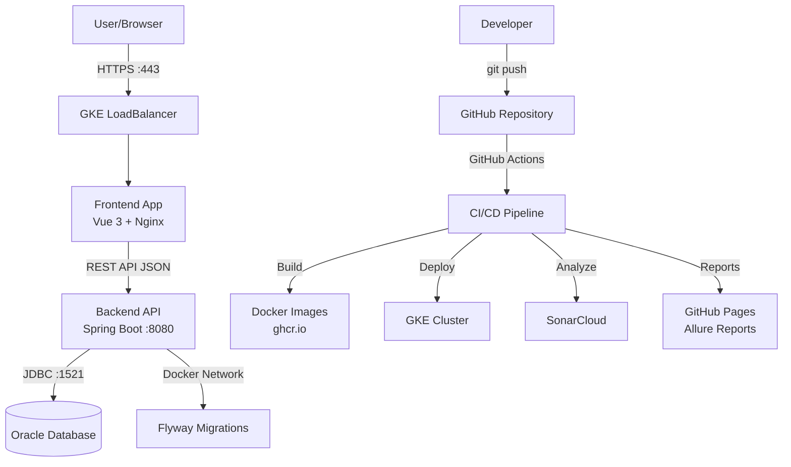

### C4 Container Diagram

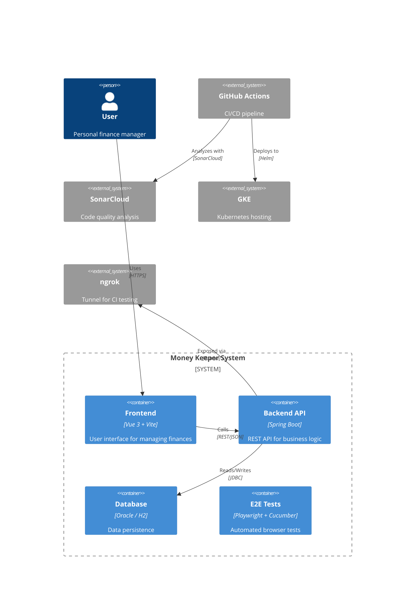

---

## ☕ Backend Architecture

### Layered Architecture

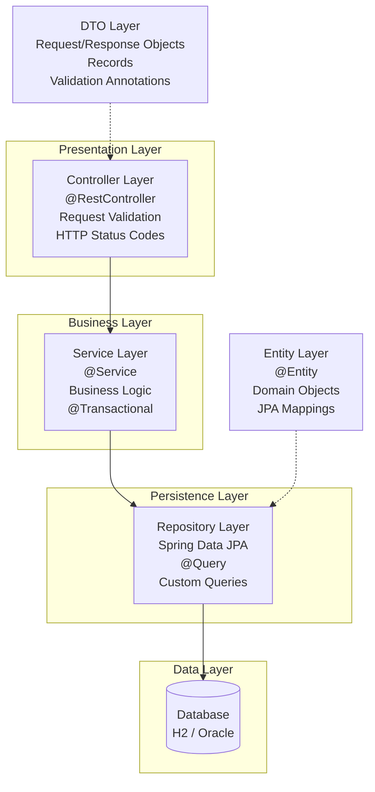

### Bounded Contexts (DDD)

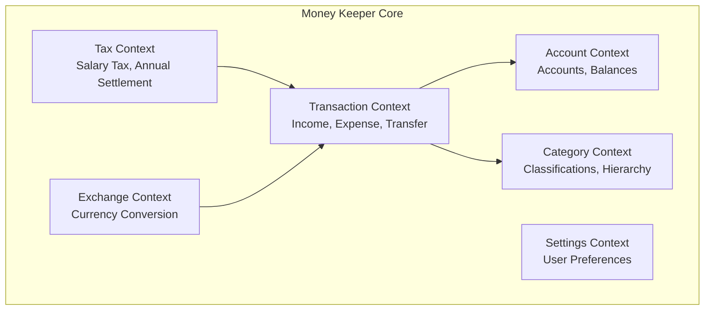

### Package Structure
```
com.personal.money.management.core
├── account/
│   ├── AccountController.java         # REST endpoints
│   ├── AccountService.java            # Business logic
│   ├── AccountRepository.java         # Data access
│   ├── Account.java                   # Domain entity
│   ├── AccountMapper.java             # Entity ↔ DTO
│   └── dto/
│       ├── CreateAccountRequest.java  # Input validation
│       ├── AccountResponse.java       # API response
│       └── AccountDTO.java            # Data transfer
├── category/
│   ├── CategoryController.java
│   ├── CategoryService.java
│   ├── CategoryRepository.java
│   ├── Category.java
│   └── dto/
├── transaction/
│   ├── TransactionController.java
│   ├── TransactionService.java
│   ├── TransactionRepository.java
│   ├── Transaction.java
│   └── dto/
├── tax/
│   ├── TaxController.java
│   ├── TaxService.java
│   ├── TaxCalculator.java
│   └── dto/
├── exchange/
│   └── ...
└── settings/
    └── ...
```

### REST Endpoints

| Method | Endpoint | Controller | Description |
|--------|----------|------------|-------------|
| GET | `/api/accounts` | Account | List all accounts |
| POST | `/api/accounts` | Account | Create account |
| GET | `/api/accounts/{id}` | Account | Get account by ID |
| PUT | `/api/accounts/{id}` | Account | Update account |
| DELETE | `/api/accounts/{id}` | Account | Delete account |
| GET | `/api/categories` | Category | List categories |
| POST | `/api/categories` | Category | Create category |
| GET | `/api/categories/{id}` | Category | Get category |
| POST | `/api/transactions` | Transaction | Create transaction |
| GET | `/api/transactions` | Transaction | List transactions |
| POST | `/api/tax/calculate` | Tax | Calculate tax |
| GET | `/api/tax/config` | Tax | Get tax configuration |
| GET | `/api/actuator/health` | Actuator | Health check |

---

## 🖥️ Frontend Architecture

### Component Architecture

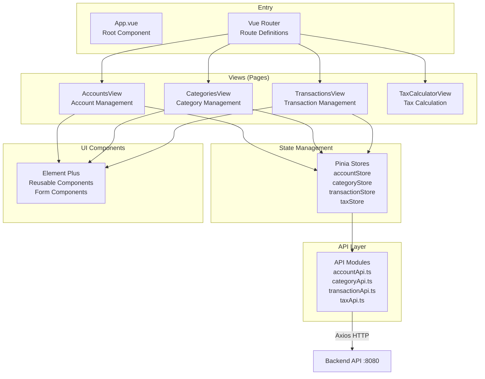

### Data Flow

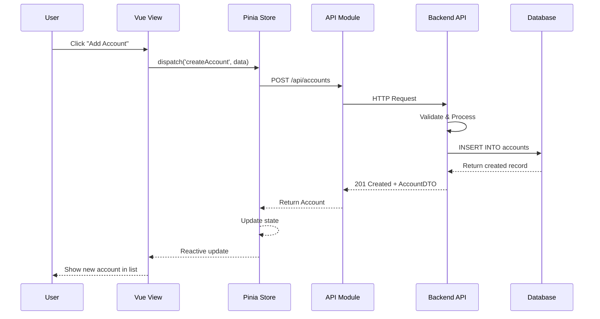

---

## 🧪 E2E Test Architecture

### Test Automation Stack

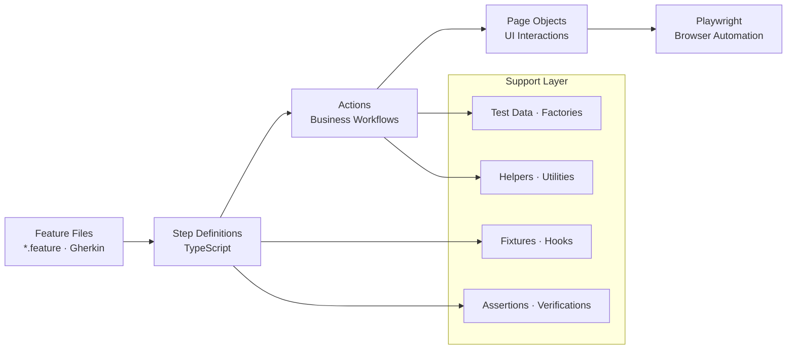

### Test Execution Flow (CI)

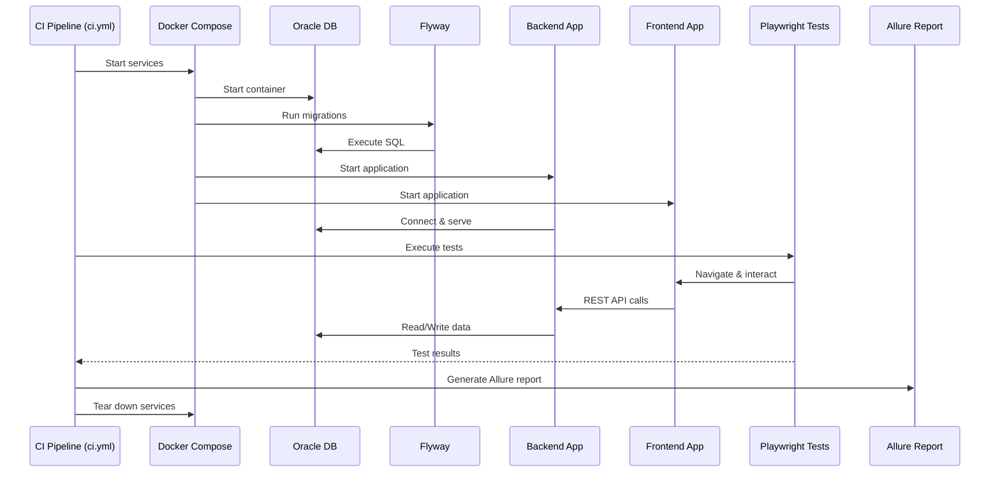

---

## 🗄️ Database Architecture

### Database Strategy

| Environment | Database | Profile | Connection | Purpose |
|-------------|----------|---------|------------|---------|
| **Local Dev** | H2 In-Memory | `local` | `jdbc:h2:mem:moneykeeper` | Fast development |
| **CI Testing** | Oracle 23c | `ci` | `jdbc:oracle:thin:@localhost:1521/FREE` | Integration tests |
| **Production** | Oracle | — | Managed | Production data |

### ER Diagram

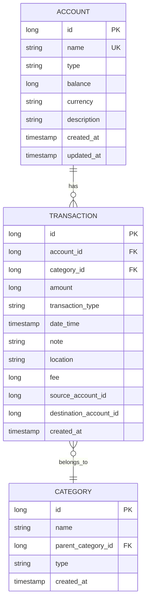

### Migration Structure

**Oracle Migrations** (`backend/src/main/resources/db/migration/oracle/`):
```
V0__create_core_user.sql       # Creates CORE schema/user (Oracle only)
V1__init.sql                   # Initial tables (accounts, categories)
V2__add_categories.sql         # Category enhancements
V4__add_transactions.sql       # Transaction table + types
V5__add_tax_tables.sql         # Tax calculation tables
```

**H2 Migrations** (`backend/src/main/resources/db/migration/h2/`):
```
V1__init.sql                   # Same schema as Oracle V1
V2__add_categories.sql         # Same as Oracle V2
V4__add_transactions.sql       # Same as Oracle V4
V5__add_tax_tables.sql         # Same as Oracle V5
```

> **Note:** Version 3 is intentionally skipped (historical gap).  
> Oracle has an additional `V0` for user creation (not needed in H2).

---

## 🚢 Deployment Architecture

### CI/CD Pipeline Architecture

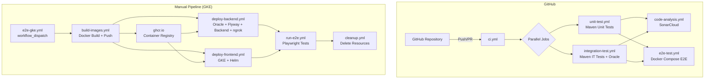

### GKE Deployment

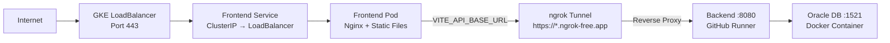

---

## 🔌 API Design

### API Conventions

| Aspect | Convention |
|--------|-----------|
| **Base URL** | `/api/{resource}` |
| **Format** | JSON (application/json) |
| **Response Envelope** | Direct object/array for success |
| **Error Format** | `{ "error": "message", "status": 400 }` |
| **Pagination** | `?page=0&size=20` with `Pageable` |
| **HTTP Methods** | GET (read), POST (create), PUT (update), DELETE (delete) |
| **Status Codes** | 200 OK, 201 Created, 204 No Content, 400 Bad Request, 404 Not Found, 409 Conflict |

### Example API Flow

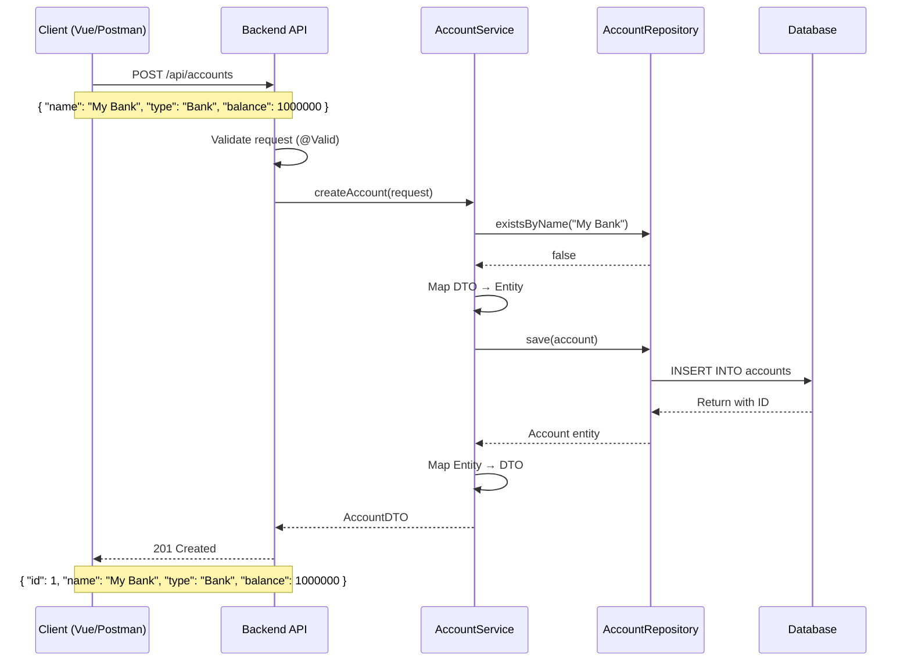

---

## 🔒 Security Architecture

### Authentication & Authorization

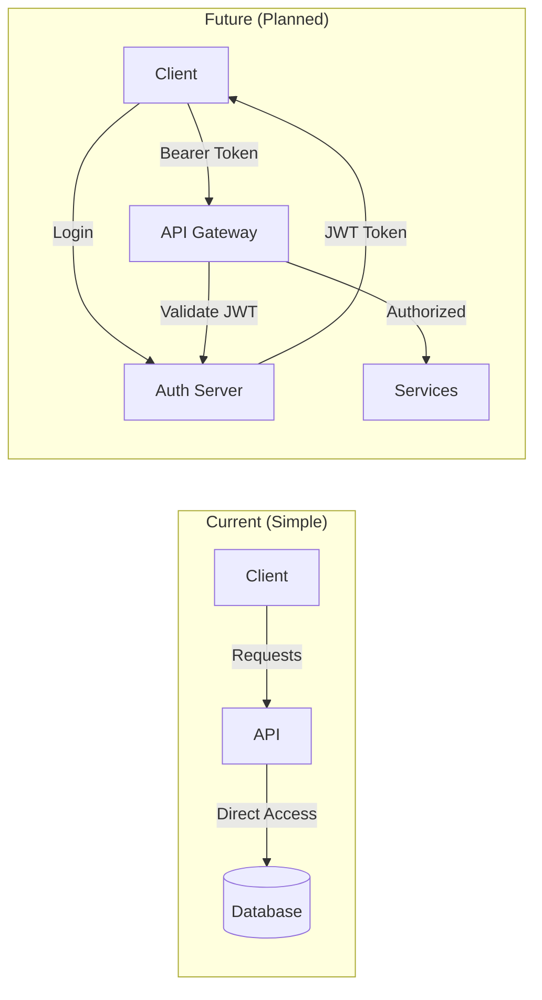

### Security Practices
- **Secrets**: All credentials stored in GitHub Secrets (never in code)
- **Database**: Oracle credentials injected via environment variables
- **GCP**: Service account with least-privilege IAM roles
- **ngrok**: Ephemeral tunnels generated per pipeline run
- **GHCR**: Images stored in private GitHub Container Registry
- **HTTPS**: LoadBalancer terminates TLS in production

---

## ✅ Technology Decisions

### Why This Stack?

| Decision | Choice | Rationale |
|----------|--------|-----------|
| **Backend Framework** | Spring Boot | Mature, extensive ecosystem, great DDD support |
| **Frontend Framework** | Vue 3 + Composition API | Lightweight, reactive, TypeScript support |
| **State Management** | Pinia | Official Vue 3 state management, TypeScript-first |
| **UI Library** | Element Plus | Comprehensive Vue 3 component library |
| **Database (Local)** | H2 | Zero-setup, in-memory, fast feedback |
| **Database (CI/Prod)** | Oracle | Enterprise-grade, project requirement |
| **ORM** | Spring Data JPA | Minimal boilerplate, custom query support |
| **Migrations** | Flyway | Version-controlled, H2 + Oracle compatible |
| **Testing (Unit)** | JUnit 5 + Mockito | Industry standard for Java |
| **Testing (E2E)** | Playwright + Cucumber | Cross-browser, BDD support, trace viewer |
| **CI/CD** | GitHub Actions | First-class GitHub integration, reusable workflows |
| **Container Registry** | ghcr.io | Built into GitHub, private packages |
| **Orchestration** | GKE + Helm | Managed Kubernetes, templated deployments |
| **Code Quality** | SonarCloud | Deep static analysis, quality gates |

---

## 📊 Architecture Decision Records (ADRs)

| ADR | Title | Decision |
|-----|-------|----------|
| [ADR-002](ADR-002-ANTI-CORRUPTION-LAYER.md) | Anti-Corruption Layer | Isolate domain from external systems |
| [ADR-003](ADR-003-AGGREGATE-ROOT-BOUNDARIES.md) | Aggregate Root Boundaries | Define clear aggregate boundaries |

### Design Principles

1. **Separation of Concerns** — Each layer has clear responsibilities
2. **Domain-Driven Design** — Models reflect business concepts, not database structure
3. **Testability** — Layers designed for isolated testing
4. **Reusability** — Components, actions, and workflows are composable
5. **Observability** — Health checks, logs, and metrics built in
6. **Security by Design** — Secrets management, least privilege, no hardcoded credentials

---

> **Last Updated**: 2026-07-16  
> **See also**: [Domain Model](domain-model.md), [Development Guide](DEVELOPMENT_GUIDE.md), [CI/CD Reference](CI_CD_REFERENCE.md)