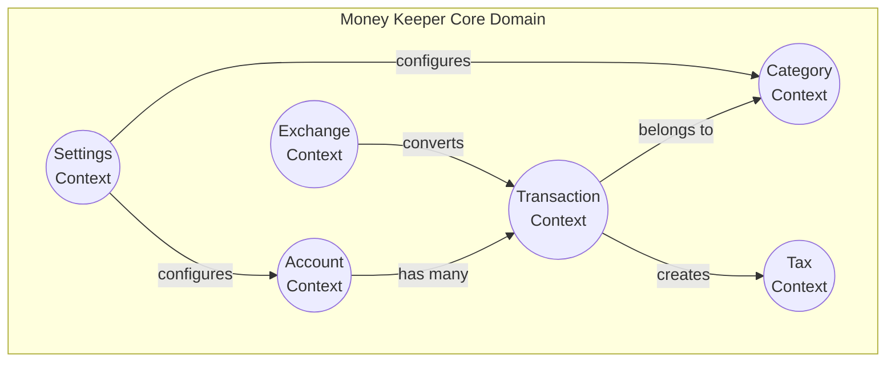
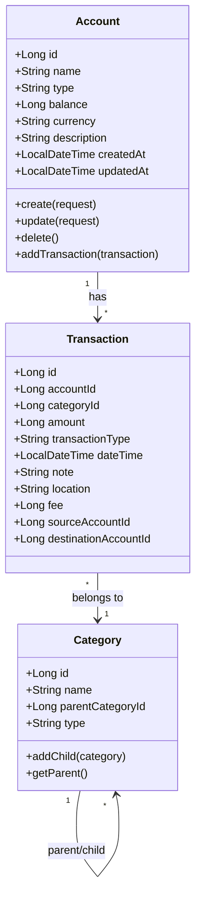
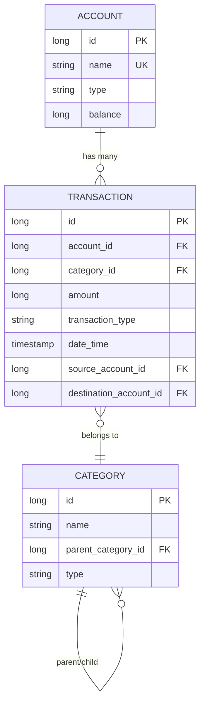
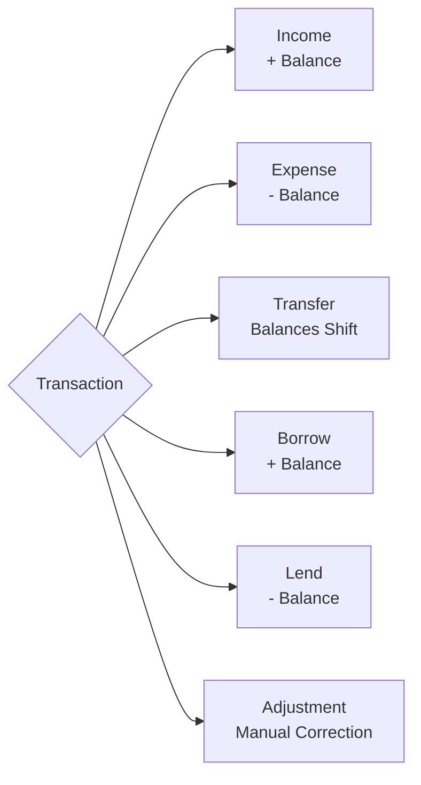
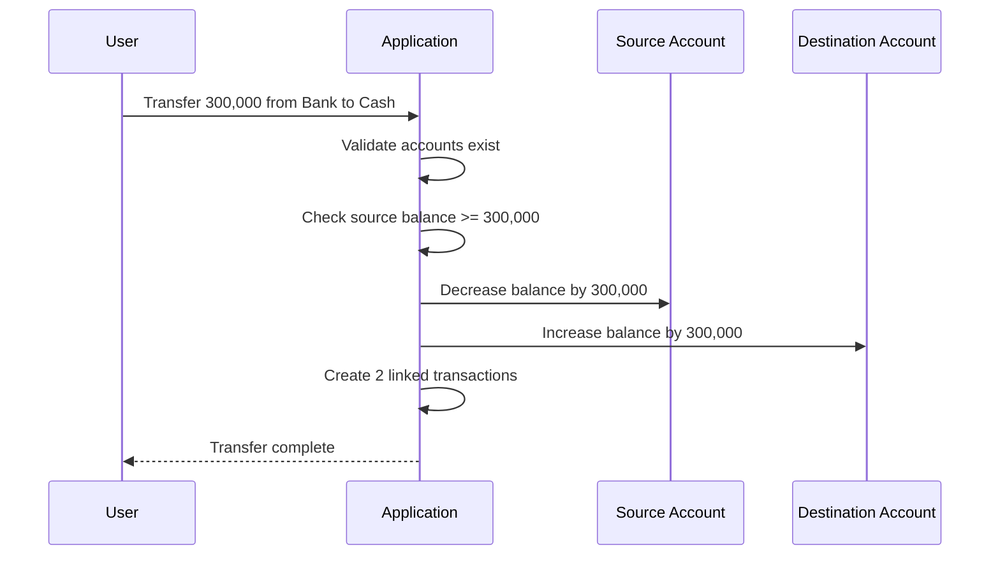
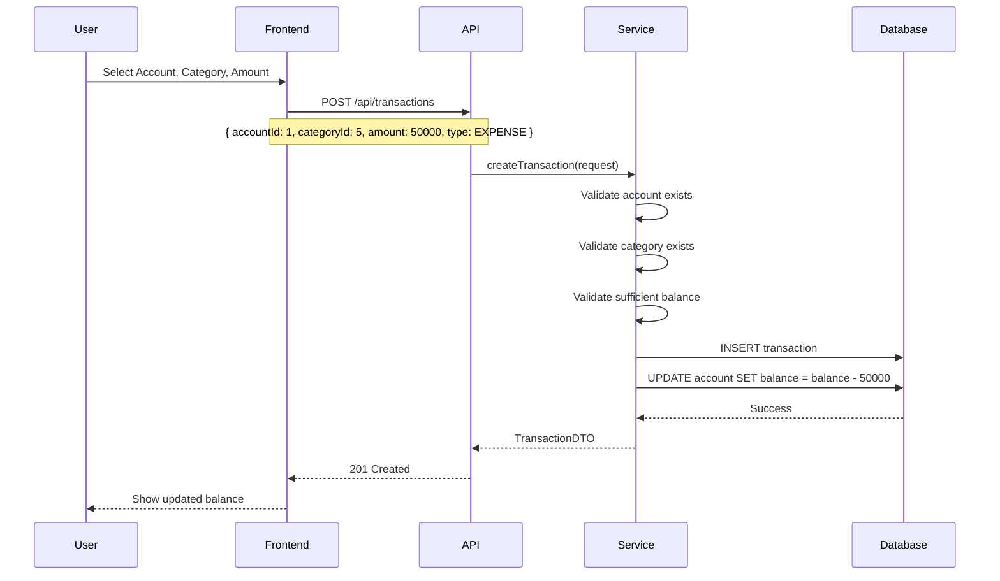
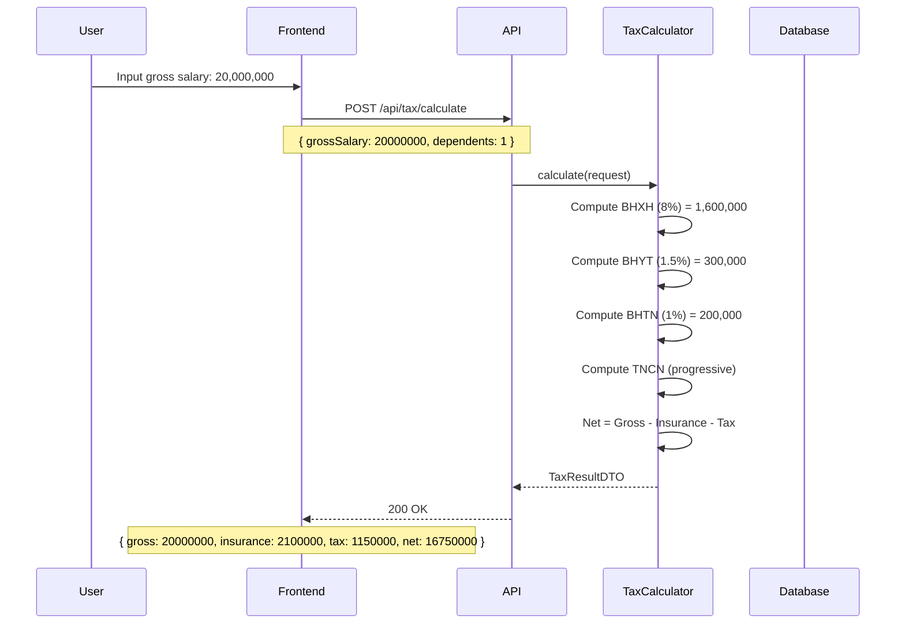
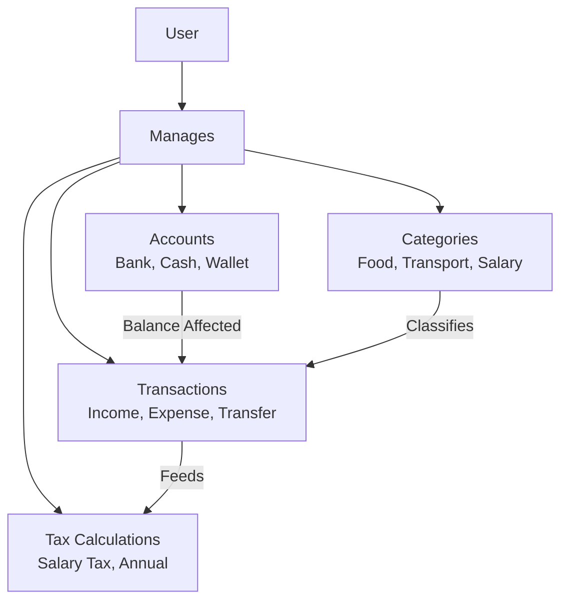

# Money Keeper — Domain Model

> **Core domain entities, relationships, business rules, and financial workflows**

---

## 📋 Table of Contents
- [Domain Overview](#-domain-overview)
- [Core Entities](#-core-entities)
- [Entity Relationships](#-entity-relationships)
- [Transaction Types](#-transaction-types)
- [Business Rules](#-business-rules)
- [Financial Workflows](#-financial-workflows)
- [Domain Events](#-domain-events)
- [Value Objects](#-value-objects)
- [Repository Map](#-repository-map)

---

## 🗺️ Domain Overview

### Bounded Context Map



### Core Concepts
- **Account**: A financial container that holds money (bank account, cash wallet)
- **Transaction**: A financial event that changes an account balance
- **Category**: A classification label for grouping transactions
- **Tax**: Tax calculation logic for salary and financial events

---

## 🧩 Core Entities

### Account



**Fields:**
| Field | Type | Description | Constraints |
|-------|------|-------------|-------------|
| `id` | Long | Primary key | Auto-generated |
| `name` | String | Account name | **Unique**, required |
| `type` | String | Account type | Bank, Cash, Wallet, etc. |
| `balance` | Long | Current balance | In smallest currency unit |
| `currency` | String | Currency code | Default: VND |
| `description` | String | Optional note | Max 255 chars |

**Business Rules:**
- Account names must be **unique** (case-insensitive)
- Balance should reflect sum of all transactions
- Deleting an account requires zero balance or force flag
- Account type is immutable after creation

---

### Transaction

**Fields:**
| Field | Type | Description | Constraints |
|-------|------|-------------|-------------|
| `id` | Long | Primary key | Auto-generated |
| `accountId` | Long | Owning account | Required, FK |
| `categoryId` | Long | Transaction category | Required, FK |
| `amount` | Long | Transaction amount | Positive for income, negative for expense |
| `transactionType` | String | Type enum | See Transaction Types below |
| `dateTime` | LocalDateTime | When transaction occurred | Required |
| `note` | String | Description | Optional |
| `location` | String | Where it happened | Optional |
| `fee` | Long | Transaction fee | Optional, >= 0 |
| `sourceAccountId` | Long | Source (for transfers) | FK |
| `destinationAccountId` | Long | Destination (for transfers) | FK |

**Business Rules:**
- Transactions are **immutable** after creation (audit trail)
- Every transaction **must** belong to exactly one category
- Transfer transactions involve exactly 2 accounts (source + destination)
- Amount cannot be zero
- A transaction can only be deleted, not modified

---

### Category

**Fields:**
| Field | Type | Description | Constraints |
|-------|------|-------------|-------------|
| `id` | Long | Primary key | Auto-generated |
| `name` | String | Category name | Required |
| `parentCategoryId` | Long | Parent category | Nullable (root) |
| `type` | String | Income or Expense | Required |

**Hierarchy Example:**
```
Food (root, Expense)
  ├── Groceries (child)
  ├── Restaurants (child)
  └── Delivery (child)
Transport (root, Expense)
  ├── Fuel
  ├── Taxi
  └── Bus
Salary (root, Income)
  └── Bonus (child)
```

**Business Rules:**
- Categories can have **unlimited depth** hierarchy
- No **cyclic** parent-child relationships allowed
- A category's type must match its parent's type
- Deleting a category reassigns transactions to a default category

---

## 🔗 Entity Relationships

### Relationship Diagram



### Cardinality Table

| Relationship | From | To | Cardinality | Description |
|-------------|------|----|-------------|-------------|
| Account → Transaction | Account | Transaction | 1:N | One account has many transactions |
| Transaction → Category | Transaction | Category | N:1 | Many transactions share one category |
| Category → Category | Category | Category | 1:N | One category has many children |
| Transfer → Account | Transaction | Account | N:1 | Transfer has source + destination |

---

## 📊 Transaction Types



| Type | Code | Effect on Balance | Description |
|------|------|-------------------|-------------|
| **Income** | `INCOME` | + Increase | Money received (salary, gift, interest) |
| **Expense** | `EXPENSE` | - Decrease | Money spent (food, transport, bills) |
| **Transfer** | `TRANSFER` | Source -, Dest + | Money moved between accounts |
| **Borrow** | `BORROW` | + Increase | Money borrowed from someone |
| **Lend** | `LEND` | - Decrease | Money lent to someone |
| **Adjustment** | `ADJUSTMENT` | ± Correction | Manual balance correction |

### Transfer Flow



---

## 📜 Business Rules

### Account Rules
1. **Unique Name**: No two accounts can have the same name
2. **Non-Negative Balance**: Balance cannot go below zero for non-credit accounts
3. **Delete Protection**: Cannot delete account with non-zero balance (unless forced)
4. **Type Immutable**: Account type cannot change after creation

### Transaction Rules
1. **Immutability**: Transactions cannot be edited, only deleted
2. **Category Required**: Every transaction needs a category
3. **Amount Non-Zero**: Transaction amount must be > 0
4. **Transfer Pairing**: Transfer creates entries in both accounts
5. **Date Range**: Transaction date cannot be in the future

### Category Rules
1. **No Cycles**: Category hierarchy cannot have circular references
2. **Type Consistency**: Child inherits parent's type (Income/Expense)
3. **Root Categories**: Must have explicit type (no parent)
4. **Safe Delete**: Deleting a category reassigns children to parent

### Tax Rules
1. **Progressive Tax**: Vietnamese personal income tax brackets
2. **Deductions**: Standard family deductions apply
3. **Social Insurance**: 8% BHXH, 1.5% BHYT, 1% BHTN
4. **Regional Minimum**: Based on regional minimum wage

---

## 💰 Financial Workflows

### Creating an Expense



### Monthly Salary Flow



---

## 📨 Domain Events

| Event | Triggered By | Payload | Consumers |
|-------|-------------|---------|-----------|
| `AccountCreated` | Account creation | Account ID, name, type | Notification service |
| `AccountBalanceChanged` | Transaction created | Account ID, delta, new balance | Reporting, audit |
| `TransactionCreated` | New transaction | Transaction ID, amount, type | Tax calculator |
| `CategoryHierarchyChanged` | Category add/remove | Category ID, parent ID | UI refresh |
| `TaxCalculated` | Tax calculation | Gross, deductions, net | Reporting |

---

## 📦 Value Objects

| Value Object | Fields | Used In | Description |
|-------------|--------|---------|-------------|
| `Money` | `amount`, `currency` | Account, Transaction | Monetary value with currency |
| `TransactionType` | `code`, `label` | Transaction | Enum of transaction types |
| `CategoryType` | `code` | Category | Income or Expense |
| `DateRange` | `start`, `end` | Reports | Date filtering |
| `TaxBracket` | `from`, `to`, `rate` | Tax | Tax rate bracket |

---

## 🗺️ Repository Map

### Source Code Locations

| Entity | Backend Location | Frontend Location | E2E Location |
|--------|-----------------|-------------------|--------------|
| **Account** | `backend/.../account/` | `frontend/src/api/accountApi.ts` | `e2e/actions/accounts/` |
| **Category** | `backend/.../category/` | `frontend/src/api/categoryApi.ts` | `e2e/actions/categories/` |
| **Transaction** | `backend/.../transaction/` | `frontend/src/api/transactionApi.ts` | `e2e/actions/transactions/` |
| **Tax** | `backend/.../tax/` | `frontend/src/views/TaxCalculatorView.vue` | `e2e/actions/tax/` |

### Database Tables

| Table | Description | Migration File |
|-------|-------------|----------------|
| `ACCOUNTS` | Account storage | `V1__init.sql` |
| `CATEGORIES` | Category with hierarchy | `V1__init.sql` |
| `TRANSACTIONS` | All transaction records | `V4__add_transactions.sql` |
| `TAX_CONFIG` | Tax calculation config | `V5__add_tax_tables.sql` |
| `TAX_HISTORY` | Tax calculation history | `V5__add_tax_tables.sql` |

---

## ✅ Summary

### Domain Model at a Glance



### Key Principles
1. **Accounts** store balances; **Transactions** record history
2. **Transactions are immutable** — never edited, only created or deleted
3. **Categories organize** transactions hierarchically
4. **Transfers involve two accounts** — source decreases, destination increases
5. **Tax calculations** are based on Vietnamese regulations
6. **Domain logic lives in Services** — not in Controllers or Repositories

---

> **Last Updated**: 2026-07-16  
> **See also**: [Architecture](architecture.md), [Development Guide](DEVELOPMENT_GUIDE.md), [Testing Strategy](TESTING_STRATEGY.md)